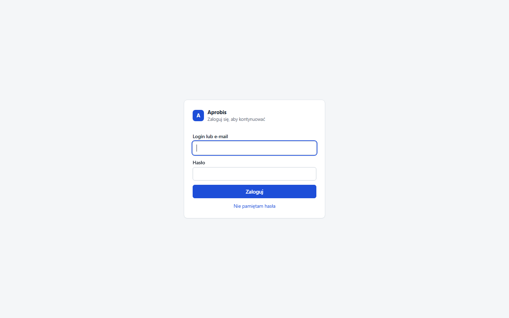
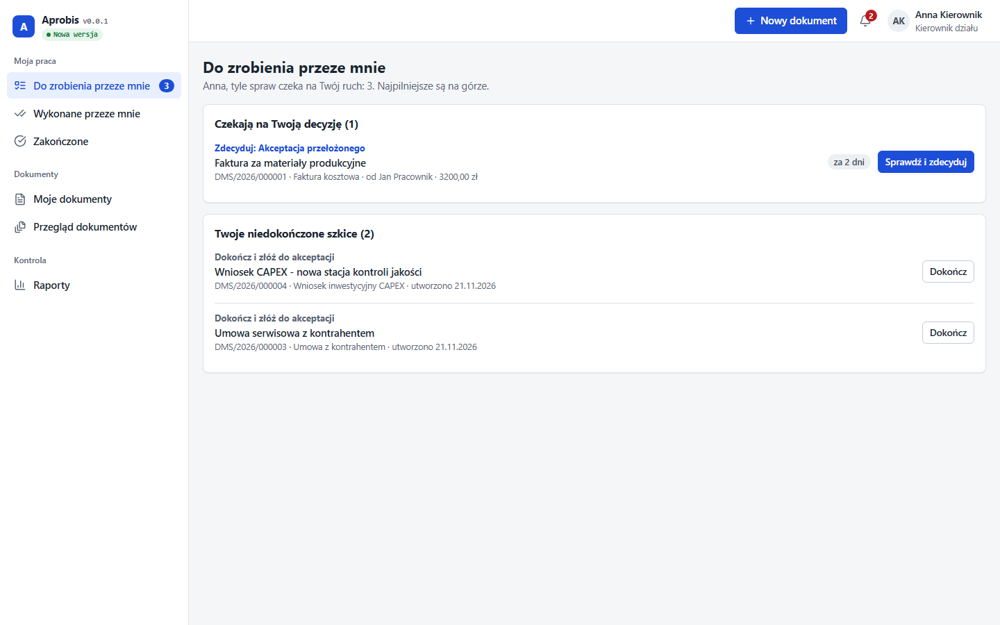
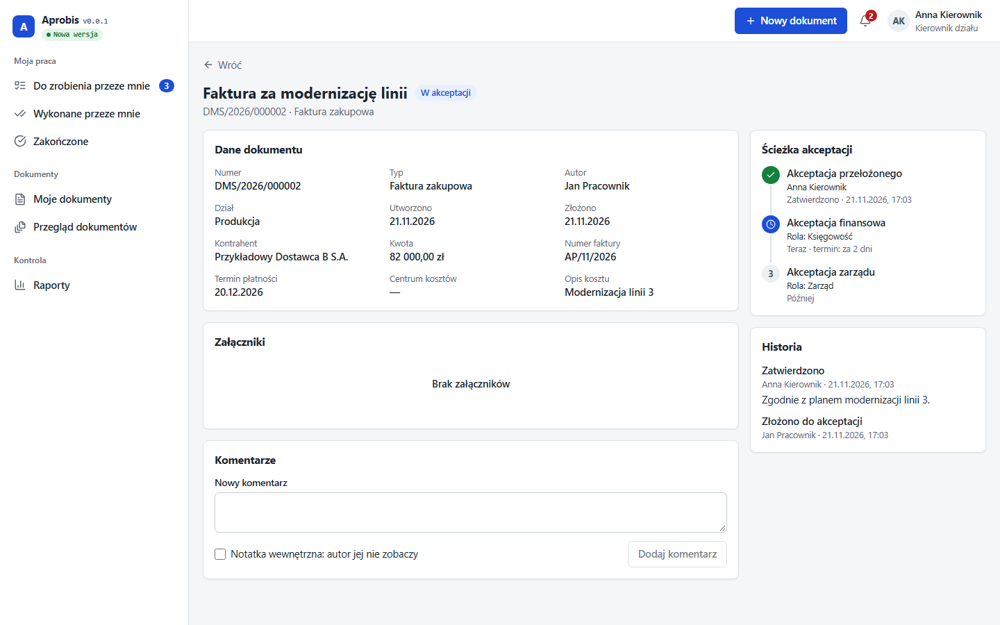
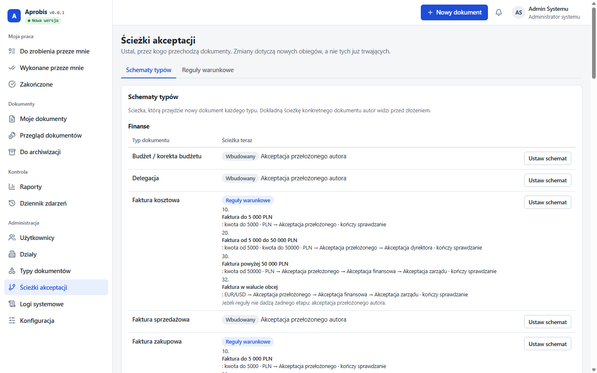

# Aprobis

**English** · [Polski](README.pl.md)

Aprobis is an open-source (MIT) document workflow and approval system for companies: an employee creates a document, the system determines who must approve it, and each decision is recorded.

> [!WARNING]
> **Early version (0.0.1), not production-tested.** Aprobis has not yet been deployed in production. The Docker setup was tested end to end on a local machine; the Windows Server installer (`deployment/Install-Aprobis.ps1`) has **not** been run end to end on a clean Windows Server yet. Expect bugs and breaking changes; test on a non-production machine first and report problems in GitHub Issues. Test checklist: [docs/test-instalacji-windows.md](docs/test-instalacji-windows.md).

## What it does

- Document types with their own forms (invoices, contracts, leave requests, purchase orders and more).
- Rule-based approval paths by amount, department and category, with approval limits and line managers.
- Decision and “for information” stages, returns for correction, deputies and task hand-over.
- Deadlines, reminders and email notifications about new tasks.
- Decision audit trails, antivirus scanning of attachments and reports.

The interface is **in Polish only**. Version **0.0.1** is in early development.

## Screenshots

Sign-in screen:



Personal work queue with a task awaiting decision:



Document in approval with its approval path and decision history:



Approval-path settings for document types:



## Choose an installation method

| Method | Best for | Requirements |
| --- | --- | --- |
| [Docker](#docker-quick-start) | Fastest way to try Aprobis | Linux x86-64 or Windows x86-64 with Docker Desktop using Linux/WSL2 containers; at least 8 GiB RAM for Docker; Node.js 22+ on the host to generate secrets |
| [Windows Server](#windows-server-installation) (not yet tested end to end) | Production installation with IIS | Windows Server 2019/2022, Node.js 22+, SQL Server; IIS with URL Rewrite and ARR for IIS mode |
| [Local development](#local-development) | Work on the source code | Node.js 22+, SQL Server with TCP enabled |

## Docker quick start

Allow about 15 minutes; the first run downloads images and ClamAV signatures and may take longer. Install Docker Compose v2 and Node.js 22+ on the host, then run:

```bash
git clone https://github.com/piotr69/aprobis.git
cd aprobis
cp .env.docker.example .env.docker   # PowerShell: Copy-Item .env.docker.example .env.docker
node scripts/create-docker-secrets.mjs
```

In `.env.docker`, set `ADMIN_EMAIL`, `ADMIN_FIRST_NAME` and `ADMIN_LAST_NAME`; `ADMIN_LOGIN` defaults to `admin`. Read the [SQL Server license terms](https://go.microsoft.com/fwlink/?LinkId=746388), then set `ACCEPT_EULA=Y`. Keep the local `PUBLIC_URL`, `COOKIE_SECURE` and `TRUST_PROXY_HOPS` defaults for a single-user trial. Protect `.env.docker` and `.secrets/` from other host users.

```bash
docker compose --env-file .env.docker config --quiet
docker compose --env-file .env.docker build
docker compose --env-file .env.docker up -d
docker compose --env-file .env.docker ps -a
```

Wait for `migrate` to show `Exited (0)` and the other services to become `healthy` (`docker compose --env-file .env.docker logs --tail 100 migrate clamav` helps diagnose startup). Open <http://localhost:3000> and sign in with `ADMIN_LOGIN` (or the email you set) and the password in `.secrets/admin-password`. The file contains the initial password; changing it in the app does not update the file. Docker does not create demo accounts.

For HTTPS, backups, upgrades and scanner configuration, follow the [full Docker guide](docs/instalacja-docker.md) (Polish). To run without ClamAV, set `AV_SCANNER=disabled` and add `-f docker-compose.yml -f docker-compose.disabled.yml` to **every** Compose command, before the subcommand; attachments will not be scanned.

## Windows Server installation

Use [deployment/Install-Aprobis.ps1](deployment/Install-Aprobis.ps1) from an elevated Windows PowerShell session. It requires Node.js 22+, SQL Server with TCP enabled and sufficient rights to create the database and login. IIS mode also requires IIS, URL Rewrite and ARR with proxy enabled; an HTTPS URL needs a certificate in `LocalMachine\My`. From the `deployment` directory, replace the URL and certificate thumbprint with your values:

```powershell
.\Install-Aprobis.ps1 -Mode Check -PublicUrl https://aprobis.example.com -ProxyMode IIS -CertificateThumbprint <thumbprint>
.\Install-Aprobis.ps1 -Mode Install -PublicUrl https://aprobis.example.com -ProxyMode IIS -CertificateThumbprint <thumbprint>
```

`Check` reports missing requirements without changing the system; `Install` prompts for the first administrator. See the [Windows Server installation guide](docs/instalacja-windows.md) (Polish) for permissions, other proxy modes and upgrades.

## Local development

Copy `.env.example` to `.env`, set `DATABASE_URL`, and create an empty SQL Server database (for example, `CREATE DATABASE Aprobis;`). Then:

```bash
npm ci
npm run db:generate
npm run db:migrate:deploy
npm run db:seed -- --yes-delete-all   # demo data; DELETES everything in this database
npm run dev
```

The app runs at <http://localhost:3000> and the API at <http://localhost:4000/api>. `npm run dev` starts the API, web front end and worker; without the worker, attachments remain in “Scanning…” and deadline reminders are not sent. **Use the seed and its publicly known demo passwords only in a disposable development database. Never run it in production.** Demo accounts include `admin` / `Admin#2026`; the full list is in [README.pl.md](README.pl.md#konta-przykładowe).

For a fresh database without demo data, run `npm run db:migrate:deploy`, `npm run db:bootstrap`, then `npm run db:create-admin` to create the first administrator.

## First steps after installation

1. Sign in as the first administrator and change the initial password.
2. Add departments and users. The system administrator does not approve business documents; give approvers their own roles.
3. Configure approval paths and approval limits for your document types.
4. Configure SMTP under **Administracja → Konfiguracja** for notifications and password reset emails.

For day-to-day usage and administration details, open the [User guide (PDF)](docs/Aprobis-user-guide.pdf) (also in [Polish PDF](docs/Aprobis-instrukcja-obslugi.pdf)). The Markdown files ([English](docs/user-guide.md), [Polish](docs/instrukcja-obslugi.md)) are kept as a knowledge source for a company AI assistant.

## Configuration

| Setting | Purpose |
| --- | --- |
| `DATABASE_URL` | SQL Server connection for local or Windows installations; Docker generates its connection from secrets. |
| `FRONTEND_URL` | Public front-end origin used by the API outside Docker. |
| `AV_SCANNER` | `defender`, `clamav` or deliberately `disabled`; Docker defaults to `clamav`. |
| `SMTP_*` | Mail server, credentials and sender for notifications and password resets. |
| `COOKIE_SECURE` | Secure session cookies over HTTPS; `false` only for local HTTP. |
| `TRUST_PROXY_HOPS` | Number of trusted proxy hops in front of the API. |

See [.env.example](.env.example) for local/Windows settings and [.env.docker.example](.env.docker.example) for Docker settings.

## Limitations

- The interface is available only in Polish, and Microsoft SQL Server is the only supported database.
- Electronic signatures are not provided.
- Version 0.0.1 is early software; behavior and configuration may change.
- Docker serves only the local front end by default; production HTTPS requires your own reverse proxy.

## Bugs, security and contributions

Use [GitHub Issues](https://github.com/piotr69/aprobis/issues) for bugs and ideas. Report vulnerabilities **privately**, as described in [SECURITY.md](SECURITY.md), not in a public issue. See [CONTRIBUTING.md](CONTRIBUTING.md) to contribute.

## Documentation (Polish, except where noted)

- [Docker installation](docs/instalacja-docker.md) · [Windows Server installation](docs/instalacja-windows.md)
- User guide: [English PDF](docs/Aprobis-user-guide.pdf) · [Polish PDF](docs/Aprobis-instrukcja-obslugi.pdf) (Markdown for a company AI assistant: [EN](docs/user-guide.md), [PL](docs/instrukcja-obslugi.md))
- [Workflow and roles](docs/workflow.md) · [API](docs/api.md) · [Data model](docs/model-danych.md) · [Migrations](prisma/MIGRATIONS.md)
- [Security](SECURITY.md) · [Contributing](CONTRIBUTING.md) · [Third-party notices](THIRD_PARTY_NOTICES.md)

## License

Aprobis is licensed under [MIT](LICENSE). SQL Server and ClamAV have their own licenses; see [THIRD_PARTY_NOTICES.md](THIRD_PARTY_NOTICES.md).
