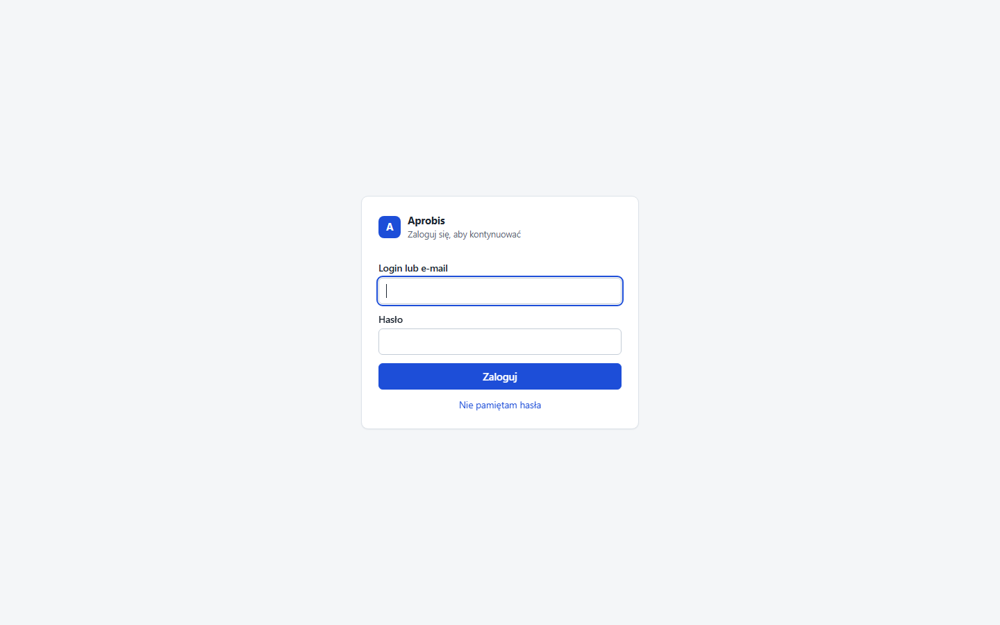
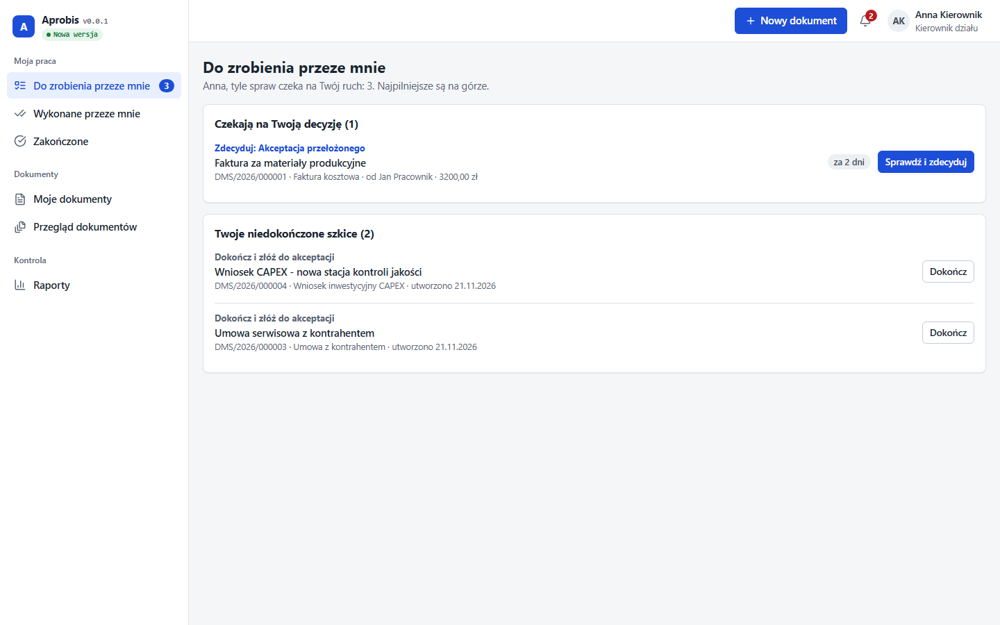
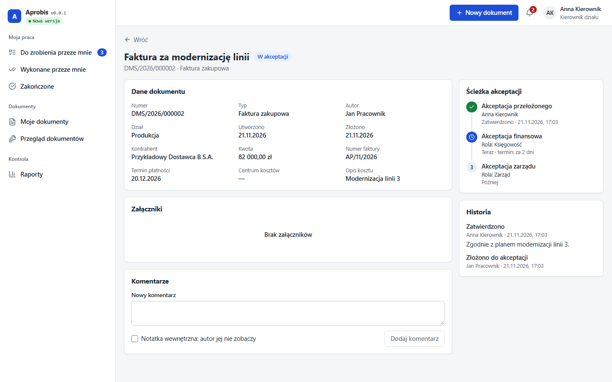
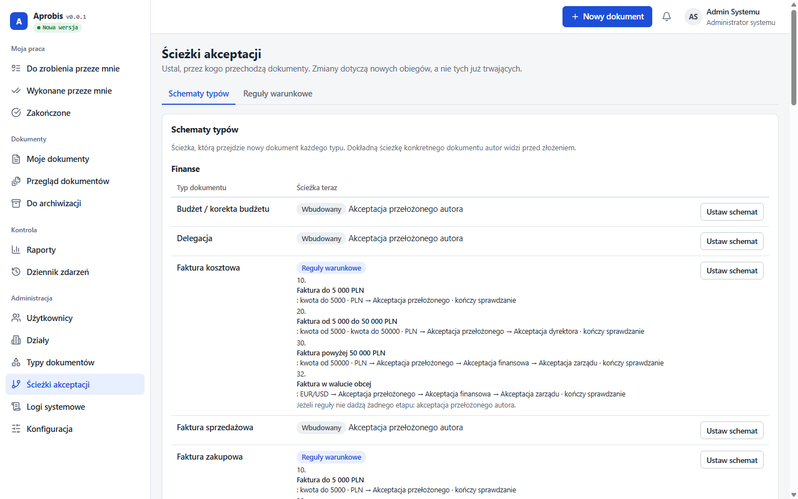

# Aprobis

[English](README.md) · **Polski**

Aprobis to otwarty (licencja MIT) program do elektronicznego obiegu i akceptacji dokumentów w firmie: pracownik tworzy dokument, system ustala, kto ma go zaakceptować, a każda decyzja zostaje zapisana.

> [!WARNING]
> **Wczesna wersja (0.0.1), nieprzetestowana produkcyjnie.** Aprobis nie był jeszcze wdrożony produkcyjnie. Instalacja w Dockerze została przetestowana w całości na komputerze lokalnym; instalator Windows Server **nie był jeszcze uruchomiony w całości** na czystym serwerze. Możliwe błędy i niezgodne zmiany w kolejnych wersjach; najpierw testuj na maszynie nieprodukcyjnej i zgłaszaj problemy w GitHub Issues. Lista testu: [docs/test-instalacji-windows.md](docs/test-instalacji-windows.md).

## Co robi

- Typy dokumentów z własnymi formularzami (faktury, umowy, wnioski urlopowe, zamówienia i inne).
- Ścieżki akceptacji według kwoty, działu i kategorii, z limitami akceptacji i przełożonymi.
- Etapy decyzyjne i „do wiadomości”, zwroty do poprawy, zastępstwa i przekazanie zadania.
- Terminy, przypomnienia i powiadomienia e-mail o nowych zadaniach.
- Historia decyzji, skanowanie załączników antywirusem i raporty.

Interfejs jest **tylko po polsku**. Wersja **0.0.1** jest na wczesnym etapie rozwoju.

## Zrzuty ekranu

Ekran logowania:



Lista pracy z zadaniem do decyzji:



Dokument w trakcie akceptacji ze ścieżką i historią decyzji:



Ustawienia ścieżek akceptacji dla typów dokumentów:



## Wybierz sposób instalacji

| Sposób | Zastosowanie | Wymagania |
| --- | --- | --- |
| [Docker](#szybki-start-z-dockerem) | Najszybszy sposób wypróbowania Aprobis | Linux x86-64 lub Windows x86-64 z Docker Desktop i kontenerami Linux/WSL2; co najmniej 8 GiB RAM dla Dockera; Node.js 22+ na hoście do wygenerowania sekretów |
| [Windows Server](#instalacja-na-windows-server) (jeszcze nieprzetestowany w całości) | Instalacja produkcyjna z IIS | Windows Server 2019/2022, Node.js 22+, SQL Server; IIS z URL Rewrite i ARR dla trybu IIS |
| [Rozwój lokalny](#rozwój-lokalny) | Praca nad kodem | Node.js 22+, SQL Server z włączonym TCP |

## Szybki start z Dockerem

Zarezerwuj około 15 minut; pierwszy start pobiera obrazy i sygnatury ClamAV i może potrwać dłużej. Zainstaluj Docker Compose v2 i Node.js 22+ na hoście, a następnie:

```bash
git clone https://github.com/piotr69/aprobis.git
cd aprobis
cp .env.docker.example .env.docker   # PowerShell: Copy-Item .env.docker.example .env.docker
node scripts/create-docker-secrets.mjs
```

W pliku `.env.docker` uzupełnij `ADMIN_EMAIL`, `ADMIN_FIRST_NAME` i `ADMIN_LAST_NAME`; domyślny `ADMIN_LOGIN` to `admin`. Przeczytaj [warunki licencji SQL Server](https://go.microsoft.com/fwlink/?LinkId=746388), a potem ustaw `ACCEPT_EULA=Y`. Do lokalnego testu jednego użytkownika pozostaw domyślne `PUBLIC_URL`, `COOKIE_SECURE` i `TRUST_PROXY_HOPS`. Chroń `.env.docker` i `.secrets/` przed innymi użytkownikami hosta.

```bash
docker compose --env-file .env.docker config --quiet
docker compose --env-file .env.docker build
docker compose --env-file .env.docker up -d
docker compose --env-file .env.docker ps -a
```

Poczekaj, aż `migrate` pokaże `Exited (0)`, a pozostałe usługi będą `healthy` (przy problemach sprawdź `docker compose --env-file .env.docker logs --tail 100 migrate clamav`). Otwórz <http://localhost:3000> i zaloguj się loginem `ADMIN_LOGIN` (lub podanym e-mailem) oraz hasłem z `.secrets/admin-password`. Plik zawiera hasło początkowe; zmiana hasła w aplikacji nie aktualizuje pliku. Docker nie tworzy kont demonstracyjnych.

Opis HTTPS, kopii, aktualizacji i skanera znajdziesz w [pełnej instrukcji Dockera](docs/instalacja-docker.md). Aby uruchomić system bez ClamAV, ustaw `AV_SCANNER=disabled` i dodaj `-f docker-compose.yml -f docker-compose.disabled.yml` do **każdego** polecenia Compose przed podkomendą; załączniki nie będą skanowane.

## Instalacja na Windows Server

Uruchom [deployment/Install-Aprobis.ps1](deployment/Install-Aprobis.ps1) w Windows PowerShell jako administrator. Potrzebujesz Node.js 22+, SQL Server z włączonym TCP oraz uprawnień do utworzenia bazy i loginu. Tryb IIS wymaga też IIS, URL Rewrite i ARR z włączonym proxy; adres HTTPS wymaga certyfikatu w `LocalMachine\My`. W katalogu `deployment` podstaw własny adres i odcisk certyfikatu:

```powershell
.\Install-Aprobis.ps1 -Mode Check -PublicUrl https://aprobis.firma.pl -ProxyMode IIS -CertificateThumbprint <odcisk>
.\Install-Aprobis.ps1 -Mode Install -PublicUrl https://aprobis.firma.pl -ProxyMode IIS -CertificateThumbprint <odcisk>
```

`Check` zgłasza braki bez zmiany systemu; `Install` zapyta o dane pierwszego administratora. Szczegóły uprawnień, innych trybów proxy i aktualizacji są w [instrukcji instalacji na Windows Server](docs/instalacja-windows.md).

## Rozwój lokalny

Skopiuj `.env.example` do `.env`, ustaw `DATABASE_URL` i utwórz pustą bazę SQL Server (np. `CREATE DATABASE Aprobis;`). Następnie:

```bash
npm ci
npm run db:generate
npm run db:migrate:deploy
npm run db:seed -- --yes-delete-all   # dane przykładowe; KASUJE wszystko w tej bazie
npm run dev
```

Aplikacja: <http://localhost:3000>. API: <http://localhost:4000/api>. `npm run dev` uruchamia API, frontend i worker; bez workera załączniki pozostają w stanie „Skanowanie…”, a przypomnienia o terminach nie wychodzą. **Seeda i publicznie znanych haseł demo używaj tylko w jednorazowej bazie deweloperskiej. Nigdy nie uruchamiaj go na produkcji.**

Nowa baza bez danych przykładowych: `npm run db:migrate:deploy`, `npm run db:bootstrap`, a następnie `npm run db:create-admin` do utworzenia pierwszego administratora.

### Konta przykładowe

Tworzy je `npm run db:seed`. Hasła są publicznie znane — tylko do środowiska deweloperskiego.

| Login | Rola | Hasło |
| --- | --- | --- |
| `admin` | Administrator systemu | `Admin#2026` |
| `marek.prezes` | Zarząd | `Marek#2026` |
| `ewa.zarzad` | Zarząd | `Ewa#2026` |
| `piotr.dyrektor` | Dyrektor | `Piotr#2026` |
| `anna.kierownik` | Kierownik działu | `Anna#2026` |
| `jan.pracownik` | Pracownik | `Jan#2026` |
| `maria.ksiegowosc` | Księgowość | `Maria#2026` |
| `tomasz.prawny` | Dział prawny | `Prawny#2026` |
| `olga.zakupy` | Zakupy | `Zakupy#2026` |
| `adam.it` | IT | `IT#2026!!` |
| `karolina.hr` | Kadry | `HR#2026!!` |
| `sekretariat` | Sekretariat | `Sekretariat#2026` |
| `audytor` | Audytor | `Audytor#2026` |

## Pierwsze kroki po instalacji

1. Zaloguj się jako pierwszy administrator i zmień hasło początkowe.
2. Dodaj działy i użytkowników. Administrator systemu nie akceptuje dokumentów biznesowych; nadaj akceptującym odpowiednie role.
3. Ustaw ścieżki akceptacji i limity dla typów dokumentów.
4. Skonfiguruj SMTP w **Administracja → Konfiguracja**, aby wysyłać powiadomienia i linki do zmiany hasła.

Pełny opis codziennej pracy i administracji znajdziesz w [instrukcji obsługi](docs/instrukcja-obslugi.md) (wersja angielska: [docs/user-guide.md](docs/user-guide.md)).

## Konfiguracja

| Ustawienie | Znaczenie |
| --- | --- |
| `DATABASE_URL` | Połączenie z SQL Server dla instalacji lokalnej lub Windows; Docker tworzy je z sekretów. |
| `FRONTEND_URL` | Publiczny adres frontendu używany przez API poza Dockerem. |
| `AV_SCANNER` | `defender`, `clamav` lub świadomie `disabled`; Docker domyślnie używa `clamav`. |
| `SMTP_*` | Serwer poczty, dane logowania i nadawca powiadomień oraz linków do zmiany hasła. |
| `COOKIE_SECURE` | Bezpieczne cookie sesji przez HTTPS; `false` tylko do lokalnego HTTP. |
| `TRUST_PROXY_HOPS` | Liczba zaufanych serwerów proxy przed API. |

Szczegóły: [.env.example](.env.example) dla instalacji lokalnej/Windows i [.env.docker.example](.env.docker.example) dla Dockera.

## Ograniczenia

- Interfejs jest tylko po polsku, a jedyną obsługiwaną bazą jest Microsoft SQL Server.
- Aprobis nie zapewnia podpisu elektronicznego.
- Wersja 0.0.1 jest wczesna; działanie i konfiguracja mogą się zmieniać.
- Docker domyślnie udostępnia frontend tylko lokalnie; HTTPS na produkcji wymaga własnego reverse proxy.

## Błędy, bezpieczeństwo i współpraca

Błędy i pomysły zgłaszaj przez [GitHub Issues](https://github.com/piotr69/aprobis/issues). Podatności zgłaszaj **prywatnie** zgodnie z [SECURITY.md](SECURITY.md), nie w publicznym issue. Zasady współpracy opisuje [CONTRIBUTING.md](CONTRIBUTING.md).

## Dokumentacja

- [Instalacja Docker](docs/instalacja-docker.md) · [Instalacja Windows Server](docs/instalacja-windows.md)
- [Instrukcja obsługi](docs/instrukcja-obslugi.md) ([English](docs/user-guide.md)) · [Obieg i role](docs/workflow.md) · [Scenariusze](docs/scenariusze-testowe.md)
- [API](docs/api.md) · [Model danych](docs/model-danych.md) · [Migracje](prisma/MIGRATIONS.md)
- [Dalsza rozbudowa](docs/dalsza-rozbudowa.md) · [Bezpieczeństwo](SECURITY.md) · [Współpraca](CONTRIBUTING.md) · [Licencje zależności](THIRD_PARTY_NOTICES.md)

## Licencja

Aprobis jest na licencji [MIT](LICENSE). SQL Server i ClamAV mają własne licencje; szczegóły w [THIRD_PARTY_NOTICES.md](THIRD_PARTY_NOTICES.md).
