# Instrukcja obsługi Aprobis

> [!NOTE]
> Ten plik w formacie Markdown jest źródłem wiedzy dla asystenta AI w firmie (np. pomocnika odpowiadającego pracownikom na pytania o Aprobis). Do czytania i drukowania służy wersja PDF: [Aprobis-instrukcja-obslugi.pdf](Aprobis-instrukcja-obslugi.pdf).

Aprobis obsługuje elektroniczny obieg i akceptację dokumentów w firmie: pracownik tworzy dokument, system wyznacza ścieżkę akceptacji, a każda decyzja zapisuje się w historii i dzienniku zdarzeń.

Ta instrukcja jest przeznaczona dla dwóch grup: użytkowników pracujących z dokumentami (pracownik, osoba akceptująca, odbiorca etapu „do wiadomości”, audytor) oraz administratorów konfigurujących system po instalacji. Dokument nie opisuje instalacji ani utrzymania serwera; te procedury znajdują się w [instrukcji Docker](instalacja-docker.md) oraz [instrukcji Windows Server](instalacja-windows.md).

> [!WARNING]
> **Wczesna wersja (0.0.1).** Aprobis nie był jeszcze wdrożony produkcyjnie; zachowanie programu i układ ekranów mogą się zmieniać. Szczegóły statusu wersji znajdziesz w ostrzeżeniu na początku [README.pl.md](../README.pl.md).

Czego program świadomie nie robi:
- nie obsługuje podpisu elektronicznego;
- nie przelicza walut (obsługuje `PLN`, `EUR` i `USD` bez kursów walut);
- nie wysyła e-maili o każdym zdarzeniu (poczta wychodzi wyłącznie przy nowym zadaniu do decyzji, etapie „do wiadomości” oraz przy resecie hasła, jeśli skonfigurowano SMTP).

## Spis treści

1. [Pierwsze kroki](#1-pierwsze-kroki)
2. [Moja praca](#2-moja-praca)
3. [Dokumenty](#3-dokumenty)
4. [Akceptacja i obieg](#4-akceptacja-i-obieg)
5. [Poprawki dokumentu](#5-poprawki-dokumentu)
6. [Zastępstwa i przekazywanie zadań](#6-zastępstwa-i-przekazywanie-zadań)
7. [Raporty, dziennik zdarzeń i logi systemowe](#7-raporty-dziennik-zdarzeń-i-logi-systemowe)
8. [Administracja](#8-administracja)
9. [Role w systemie](#9-role-w-systemie)
10. [Rozwiązywanie problemów](#10-rozwiązywanie-problemów)
11. [Słowniczek](#11-słowniczek)

---

## 1. Pierwsze kroki

Logowanie działa przez przeglądarkę internetową za pomocą loginu albo adresu e-mail oraz hasła. Sesja w przeglądarce trwa 8 godzin.

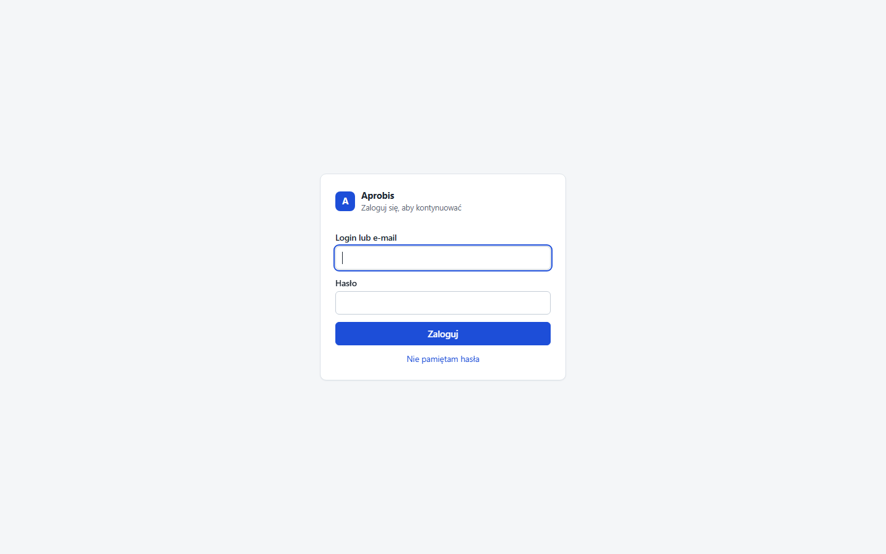

### Logowanie do programu

1. Otwórz w przeglądarce adres przekazany przez administratora.
2. Wpisz login albo e-mail w polu „Login lub e-mail”.
3. Wpisz hasło w polu „Hasło” i kliknij „Zaloguj”.

Zasady bezpieczeństwa logowania:
- po 3 nieudanych próbach konto blokuje się automatycznie na 15 minut (blokada wygasa sama, a administrator może ją zdjąć wcześniej);
- z jednego adresu IP można wykonać najwyżej 10 prób logowania w ciągu 15 minut oraz 5 żądań resetu hasła w ciągu 15 minut;
- hasło musi mieć od 8 do 128 znaków.

### Odzyskiwanie hasła („Nie pamiętam hasła”)

Odzyskiwanie hasła działa tylko wtedy, gdy administrator skonfigurował serwer poczty SMTP.

1. Na ekranie logowania kliknij „Nie pamiętam hasła”.
2. Wpisz swój login albo adres e-mail i kliknij „Wyślij link”.
3. Otwórz link z wiadomości e-mail w ciągu 1 godziny. Link działa tylko raz.
4. Wpisz nowe hasło (8-128 znaków), powtórz je i kliknij „Ustaw hasło”.

Ustawienie nowego hasła zdejmuje czasową blokadę konta i wylogowuje wszystkie aktywne sesje na innych urządzeniach. Jeśli nie masz dostępu do poczty, poproś administratora o ustawienie nowego hasła w panelu „Użytkownicy”.

### Zmiana hasła i wylogowanie

- Aby zmienić własne hasło, kliknij swoje imię i nazwisko w prawym górnym rogu, wybierz „Moje konto i zastępstwa”, a następnie w karcie „Zmiana hasła” podaj „Obecne hasło”, „Nowe hasło”, „Powtórz nowe hasło” i kliknij „Zmień hasło”. Zmiana hasła kończy wszystkie sesje, więc program poprosi o ponowne zalogowanie.
- Aby się wylogować, kliknij swoje imię i nazwisko w prawym górnym rogu i wybierz „Wyloguj”.

### Układ ekranu

Główne menu po lewej stronie dzieli się na cztery grupy (widzisz wyłącznie pozycje dostępne dla Twojej roli):

- **Moja praca:** „Do zrobienia przeze mnie” (z licznikiem otwartych spraw), „Wykonane przeze mnie”, „Zakończone”.
- **Dokumenty:** „Moje dokumenty”, „Przegląd dokumentów”, „Do archiwizacji”.
- **Kontrola:** „Raporty”, „Dziennik zdarzeń”.
- **Administracja:** „Użytkownicy”, „Działy”, „Typy dokumentów”, „Ścieżki akceptacji”, „Logi systemowe”, „Konfiguracja”.

Na górnym pasku znajdują się:
- przycisk „Nowy dokument” (widoczny dla ról z prawem tworzenia dokumentów);
- ikona dzwonka „Powiadomienia” z liczbą nieprzeczytanych wpisów (kliknięcie wpisu otwiera powiązany dokument, a przycisk „Oznacz wszystkie” kasuje licznik);
- menu użytkownika z linkiem „Moje konto i zastępstwa” oraz przyciskiem „Wyloguj”.

W lewym górnym rogu przy nazwie programu widoczny jest numer wersji (np. `v0.0.1`). Przez 2 dni od aktualizacji wersji na nowszy numer pojawia się przy nim zielony dopisek „Nowa wersja”.

---

## 2. Moja praca

Sekcja „Moja praca” skupia wyłącznie sprawy wymagające Twojego udziału oraz historię Twoich decyzji. Widoczność cudzych dokumentów z tytułu roli nigdy nie dodaje ich do Twoich zadań.

### Do zrobienia przeze mnie

To główny ekran roboczy. Pokazuje wszystko, co w tej chwili czeka na Twój ruch, podzielone na sekcje:

1. **Czekają na Twoją decyzję:** zadania akceptacyjne przypisane do Ciebie, do Twojej roli albo przejęte w ramach aktywnego zastępstwa. Przy każdej pozycji widać termin oraz przycisk „Sprawdź i zdecyduj”. Jeśli kwota przekracza Twój limit akceptacji, opis brzmi „Ponad Twój limit, przekaż dalej: …”.
2. **Zwrócone Ci do poprawy:** Twoje dokumenty zwrócone przez osobę akceptującą, z przyciskiem „Popraw dokument”.
3. **Twoje niedokończone szkice:** dokumenty zapisane jako szkic i jeszcze niezłożone do akceptacji, z przyciskiem „Dokończ”.
4. **Do archiwizacji:** skrót z liczbą zatwierdzonych dokumentów czekających na archiwizację (widoczny tylko dla ról uprawnionych do archiwizacji).

Gdy zastępujesz inną osobę, na górze ekranu widoczny jest baner „Masz aktywne zastępstwo” z imieniem zastępowanej osoby i datą końcową.

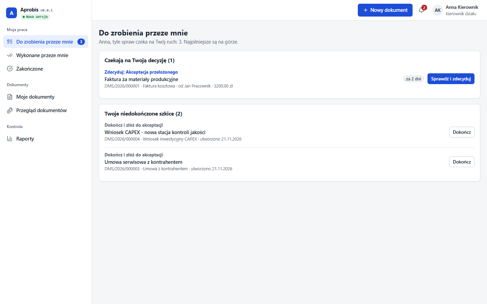

### Wykonane przeze mnie

Ekran pokazuje chronologiczną listę Twoich decyzji i złożeń wraz z komentarzami. Przy każdym wpisie po prawej stronie widać aktualny status dokumentu i stan obiegu, na przykład „Obieg trwa, teraz u: Księgowość”, „Czeka na poprawki autora” albo „Obieg zakończony”.

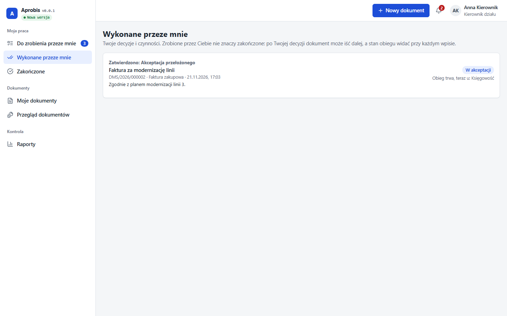

### Zakończone

Ekran zawiera dokumenty, w których brałeś udział jako autor lub osoba decydująca i których obieg już się zamknął. Zakładki u góry filtrują listę na: „Wszystkie”, „Zatwierdzone” (obejmuje też dokumenty w archiwum), „Odrzucone” oraz „Wycofane”.

---

## 3. Dokumenty

Dokument przechodzi przez stany: `Szkic` -> `W akceptacji` -> `Zatwierdzony` -> `W archiwum`. Z etapu `W akceptacji` może też trafić do stanu `Do poprawy` (po zwrocie) albo `Odrzucony` (po odrzuceniu). Ze stanu `Szkic`, `W akceptacji` lub `Do poprawy` można dokument wycofać (`Wycofany`).

### Tworzenie nowego dokumentu

Nowy dokument najpierw zapisuje się jako szkic. Dzięki temu przed złożeniem widzisz pełną ścieżkę akceptacji i możesz dopiąć załączniki.

1. Kliknij „Nowy dokument” na górnym pasku.
2. Znajdź właściwy typ dokumentu (możesz użyć pola „Szukaj, np. faktura, urlop, umowa”). Typy są pogrupowane w kategorie: „Finanse”, „Umowy”, „Kadry”, „Administracja”, „Techniczne” oraz „Jakość i zgodność”.

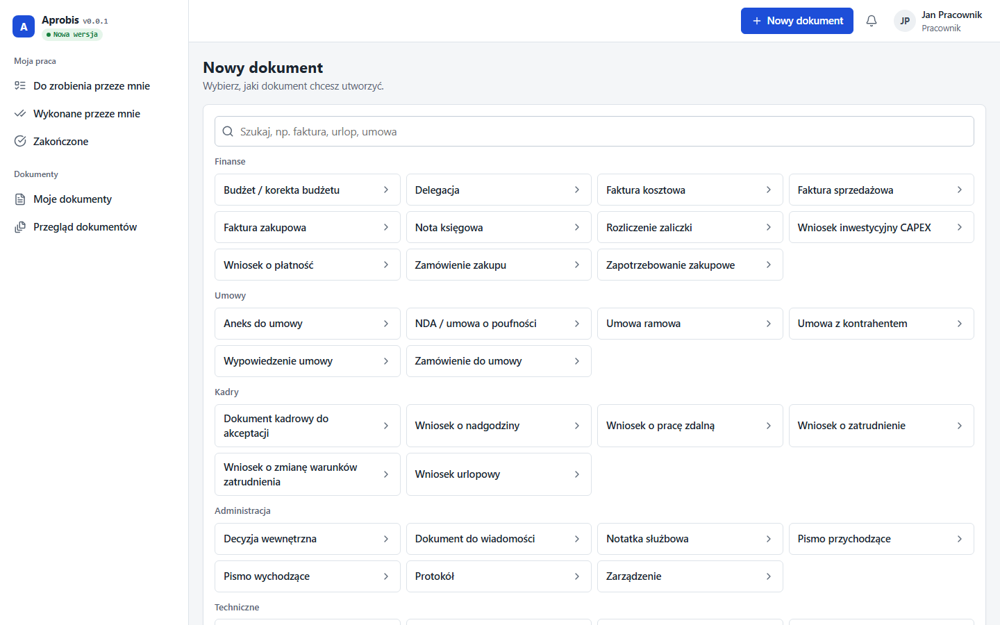

3. Kliknij wybrany typ, aby otworzyć formularz.
4. Uzupełnij „Tytuł” (dla niektórych typów tytuł powstaje automatycznie z szablonu na podstawie pozostałych pól), a jeśli typ tego wymaga, także „Kontrahent”, „Kwota”, „Waluta” (`PLN`, `EUR` lub `USD`) oraz pola specyficzne dla formularza.
5. Opcjonalnie dodaj pliki w polu „Załączniki”.
6. Kliknij „Zapisz i przejdź dalej”. System zapisze szkic i otworzy kartę dokumentu.

Pola obowiązkowe są oznaczone gwiazdką, ale weryfikowane dopiero przy składaniu dokumentu. Szkic można zapisać z niepełnymi danymi i uzupełnić później. Dział dokumentu system ustawia automatycznie na podstawie profilu autora.

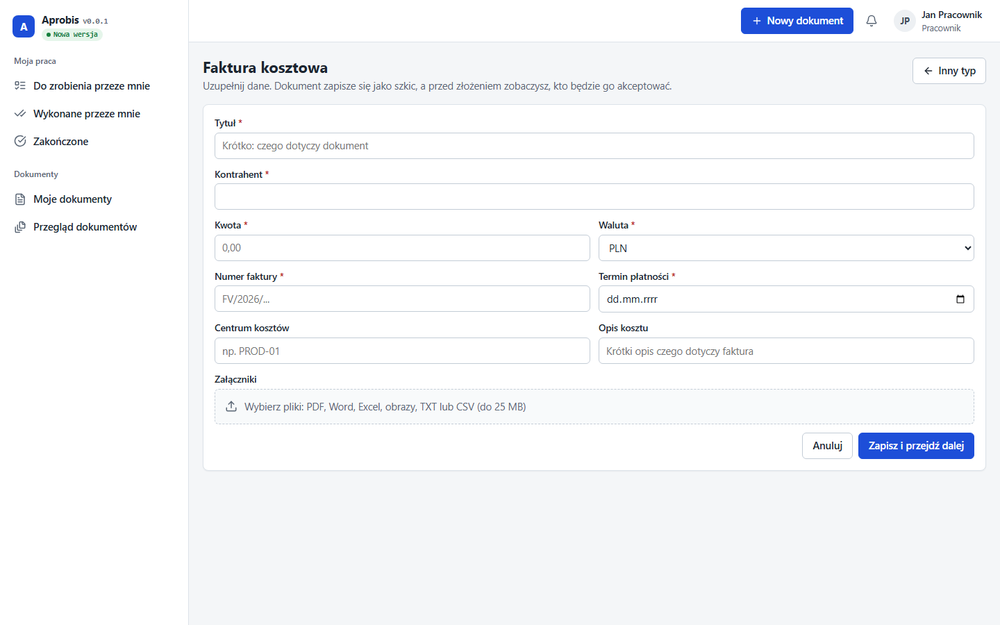

### Załączniki i skanowanie antywirusowe

Dozwolone formaty plików to: PDF, Word (`.doc`, `.docx`), Excel (`.xls`, `.xlsx`), obrazy (`.jpg`, `.jpeg`, `.png`, `.gif`), `.txt` oraz `.csv`. Maksymalny rozmiar pojedynczego pliku wynosi 25 MB. Dodawanie i usuwanie załączników jest możliwe wyłącznie dla autora w statusie „Szkic” lub „Do poprawy”.

Każdy przesłany plik trafia do skanowania antywirusowego wykonywanego w tle przez proces roboczy (worker):

| Status w interfejsie | Znaczenie | Czy plik można otworzyć lub pobrać |
| --- | --- | --- |
| `Skanowanie…` | Plik czeka w kolejce na skan antywirusowy. Ekran odświeża status automatycznie co 3 sekundy. | Nie |
| `Bezpieczny` | Skaner nie wykrył zagrożeń. | Tak (dla PDF i obrazów działa też podgląd w oknie) |
| `Zablokowany przez antywirus` | Skaner wykrył zagrożenie. Plik blokuje złożenie dokumentu do akceptacji; usuń go ikoną kosza. | Nie (trwale zablokowany) |
| `Nie skanowano` (z dopiskiem o wyłączonym antywirusie) | Administrator uruchomił instalację z wyłączonym skanowaniem (`AV_SCANNER=disabled`). Plik nie był skanowany i nie ma etykiety „Bezpieczny”. | Tak wyłącznie wtedy, gdy skanowanie jest wyłączone. Po włączeniu skanera plik wraca do kolejki skanowania i do czasu wyniku jest zablokowany. |

### Podgląd ścieżki i złożenie dokumentu

Na karcie szkicu po prawej stronie karta „Ścieżka akceptacji” pokazuje listę etapów, osoby albo role wyznaczone do decyzji oraz liczbę dni na każdy etap.

1. Sprawdź dane dokumentu, statusy załączników oraz „Ścieżkę akceptacji”.
2. Jeśli trzeba coś poprawić, kliknij „Edytuj”.
3. Kliknij „Złóż do akceptacji”.

Od chwili złożenia treści dokumentu i załączników nie można zmieniać, dopóki dokument nie zostanie zwrócony do poprawy. Jeśli w ścieżce brakuje aktywnego decydenta (np. żaden przełożony nie ma wystarczającego limitu) albo aktywna reguła jest uszkodzona, system zablokuje złożenie z komunikatem.

### Usunięcie szkicu a wycofanie dokumentu

- **Usuń szkic:** dostępne wyłącznie dla autora i tylko dla dokumentu, który nigdy nie był złożony do akceptacji. Usuwa dokument i jego załączniki trwale (operacji nie można cofnąć).
- **Wycofaj:** dostępne dla autora lub administratora dla dokumentu w statusie „W akceptacji” lub „Do poprawy” (oraz zarejestrowanego). Zatrzymuje obieg, zamyka otwarte zadania i cofa wgląd z etapów „do wiadomości”. Operacji nie można cofnąć; dokument zostaje w historii ze statusem „Wycofany”.

### Komentarze i notatki wewnętrzne

Na dole karty dokumentu znajduje się sekcja „Komentarze” (dostępna dla autora oraz osób z przypisanym zadaniem, dopóki dokument nie trafi do archiwum).

- Zwykły komentarz widzą wszyscy uczestnicy dokumentu, w tym autor.
- Osoby niebędące autorem mogą zaznaczyć pole „Notatka wewnętrzna: autor jej nie zobaczy”. Taki wpis ma etykietę „Notatka wewnętrzna” i jest ukryty przed autorem dokumentu oraz przed odbiorcami etapu „do wiadomości”.

### Moje dokumenty, Przegląd dokumentów i archiwizacja

- **Moje dokumenty:** wyłącznie dokumenty utworzone przez Ciebie, z zakładkami: „Wszystkie”, „Szkice”, „Do poprawy”, „W akceptacji”, „Zatwierdzone” oraz „Odrzucone i wycofane”.
- **Przegląd dokumentów:** wszystkie dokumenty, do których masz wgląd z tytułu udziału, bycia przełożonym lub zakresu roli. Możesz szukać po tytule, numerze lub kontrahencie oraz filtrować po statusie i typie.

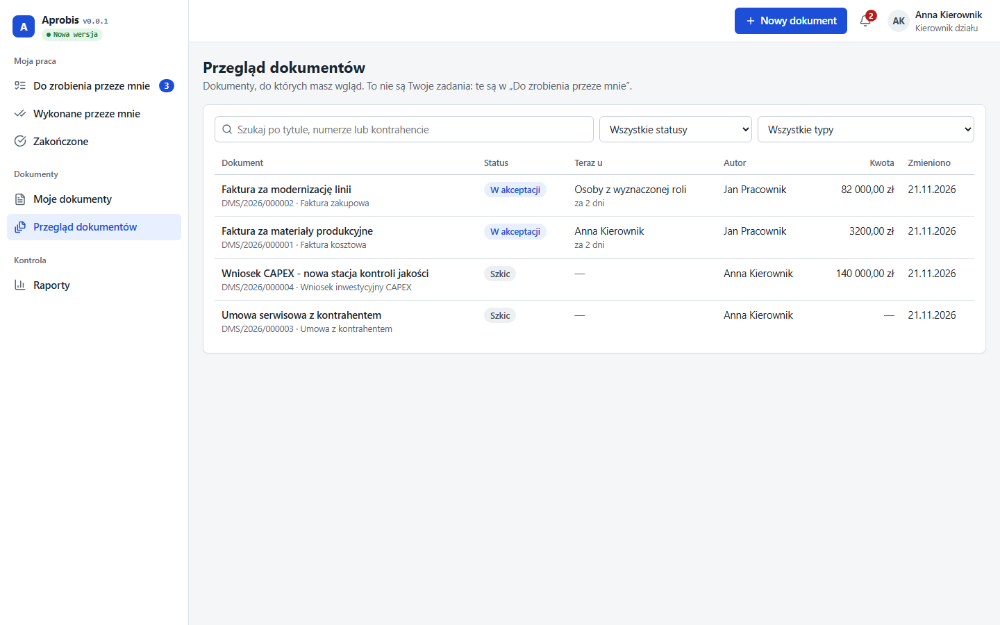

- **Do archiwizacji:** lista zatwierdzonych dokumentów gotowych do przeniesienia do archiwum (zakładki „Czekają” i „W archiwum”). Aby zarchiwizować dokument, otwórz go i kliknij „Do archiwum”. Archiwizować mogą:
  - **Kadry (HR):** wyłącznie dokumenty z kategorii „Kadry”;
  - **Sekretariat:** wszystkie zatwierdzone dokumenty poza kategorią „Kadry”;
  - **Administrator systemu:** wszystkie zatwierdzone dokumenty.

---

## 4. Akceptacja i obieg

Prawo do podjęcia decyzji wynika z przydzielonego zadania, a nie z samej roli. Nawet jeśli widzisz dokument w „Przeglądzie dokumentów”, panel decyzji pojawi się tylko wtedy, gdy zadanie należy do Ciebie, do Twojej roli albo do osoby, którą zastępujesz.

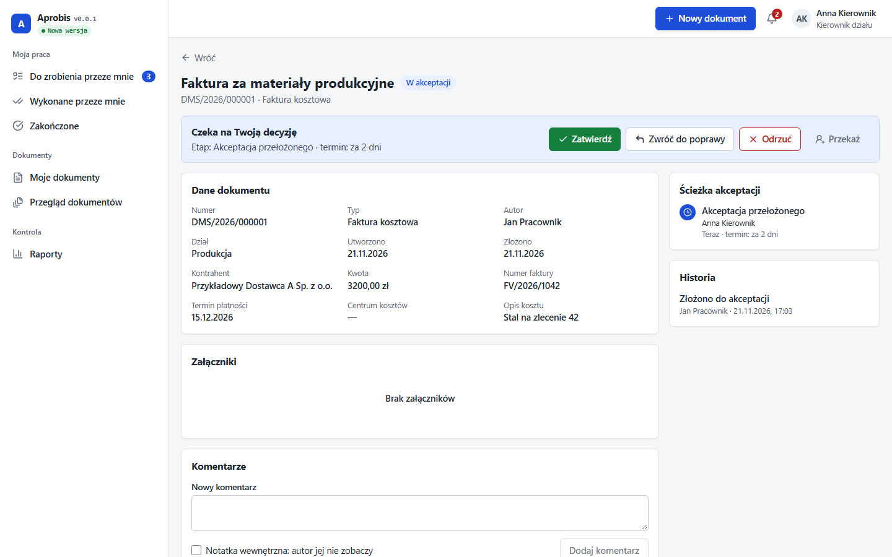

### Podejmowanie decyzji w zadaniu

1. Otwórz zadanie z listy „Do zrobienia przeze mnie” przyciskiem „Sprawdź i zdecyduj”.
2. Zapoznaj się z kartą „Dane dokumentu”, załącznikami, komentarzami i historią.
3. W panelu „Czeka na Twoją decyzję” wybierz jedną z akcji:
   - **Zatwierdź:** otwiera okno potwierdzenia (komentarz jest opcjonalny, chyba że etap ma włączoną opcję „Komentarz obowiązkowy”; komentarz widzi autor). Dokument przechodzi do kolejnego etapu albo kończy obieg jako „Zatwierdzony”.
   - **Zwróć do poprawy:** widoczne, jeśli etap na to pozwala. Wymaga wpisania pola „Co trzeba poprawić?”. Zatrzymuje bieżący obieg i oddaje dokument autorowi ze statusem „Do poprawy”.
   - **Odrzuć:** wymaga wpisania pola „Powód odrzucenia”. Natychmiast kończy obieg ze statusem „Odrzucony”; decyzji nie można cofnąć.
   - **Przekaż:** widoczne, jeśli etap na to pozwala. Otwiera okno „Przekaż zadanie” i przenosi bieżące zadanie na wskazaną aktywną osobę z prawem decyzji (z wyłączeniem autora dokumentu, samego siebie oraz ról bez prawa decyzji).

### Zasady akceptacji i limity kwotowe

- **Zakaz samoakceptacji:** autor dokumentu nie może zatwierdzić własnego dokumentu w żadnej roli. Jeśli ścieżka wskazuje autora, przy składaniu dokumentu system automatycznie zastępuje go jego przełożonym (w ścieżce pojawia się adnotacja „Autor był wskazany w tym etapie, więc decyduje przełożony”).
- **Limity akceptacji:** administrator może nadać użytkownikowi limit kwoty i waluty (`PLN`, `EUR` lub `USD`). Brak limitu oznacza brak ograniczenia; dokument bez kwoty nie przekracza żadnego limitu.
- **Przekroczenie limitu:** dokument powyżej limitu już przy składaniu trafia do pierwszego przełożonego wyżej w strukturze, którego limit wystarcza (a na końcu łańcucha do zarządu). Limit w innej walucie niż dokument zawsze traktowany jest jako przekroczony, ponieważ program nie zna kursów walut.
- **Zmiana limitu w trakcie obiegu:** limit sprawdzany jest ponownie przy decyzji. Jeśli przekraczasz limit, przycisk „Zatwierdź” jest nieaktywny; możesz wtedy użyć „Przekaż” (wyłącznie do osoby o wystarczającym limicie) albo „Zwróć do poprawy”.

### Etapy kolejne, wieloosobowe i etap „do wiadomości”

Na karcie „Ścieżka akceptacji” widać etapy ukończone (zielony znacznik, „Zatwierdzono”), etap bieżący (niebieska ikona zegara, „Teraz”) i etapy przyszłe („Później”).

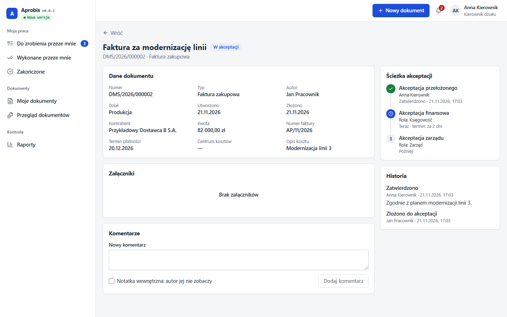

- **Etapy kolejne:** następny etap otwiera się dopiero po zakończeniu bieżącego.
- **Zadanie dla roli lub wielu osób:** gdy etap przypisano do roli (np. „Księgowość”), zadanie widzą wszystkie osoby z tej roli mające odpowiedni limit, a decyduje pierwsza z nich. Gdy stały schemat wskazuje kilka konkretnych osób, decydują wszyscy (tryb domyślny) albo wystarczy jedna decyzja, zależnie od ustawienia etapu; odrzucenie przez którąkolwiek osobę zatrzymuje cały obieg.
- **Etap „do wiadomości”:** nie tworzy zadania do decyzji i nie zatrzymuje obiegu. Gdy obieg dojdzie do tego etapu, wskazany odbiorca dostaje wgląd tylko do odczytu (bez notatek wewnętrznych i bez możliwości komentowania). Wgląd jest cofany, jeśli dokument zostanie zwrócony do poprawy lub wycofany. Wgląd „do wiadomości” nie przechodzi na zastępcę.

### Terminy, przypomnienia i wiadomości e-mail

Termin każdego etapu decyzyjnego liczy się w dniach od chwili otwarcia etapu (domyślnie 2 dni, jeśli w schemacie lub regule nie ustawiono inaczej).

- Po przekroczeniu terminu proces roboczy (worker) wysyła jednorazowe przypomnienie w aplikacji (dzwonek „Powiadomienia”), a termin wyświetla się na czerwono (np. „2 dni po terminie”).
- Jeśli administrator skonfigurował pocztę SMTP, worker wysyła wiadomość e-mail po otwarciu nowego zadania do decyzji oraz przy etapie „do wiadomości”. Ze względów poufności treść wiadomości e-mail zawiera link i informację o zadaniu, ale nie zawiera tytułu ani pól dokumentu.

---

## 5. Poprawki dokumentu

Gdy osoba akceptująca użyje przycisku „Zwróć do poprawy”, dokument wraca do autora ze statusem „Do poprawy”. Poprawka nie jest zadaniem decyzyjnym do zatwierdzenia, lecz edycją dokumentu przez autora.

1. Otwórz „Do zrobienia przeze mnie” i znajdź sekcję „Zwrócone Ci do poprawy” (dokument znajdziesz też w „Moje dokumenty” w zakładce „Do poprawy”).
2. Kliknij „Popraw dokument”. Na górze karty przeczytasz żółty baner „Zwrócono do poprawy” z opisem zmian podanym przez osobę akceptującą.
3. Kliknij „Edytuj”, wprowadź poprawki w danych i zapisz formularz.
4. Jeśli trzeba, usuń nieaktualne pliki lub dodaj nowe załączniki w sekcji „Załączniki” i poczekaj na zakończenie skanowania.
5. Sprawdź zaktualizowaną „Ścieżkę akceptacji” i kliknij „Złóż ponownie”.

Po ponownym złożeniu obieg zawsze rozpoczyna się od pierwszego etapu, ponieważ zmiana kwoty, kontrahenta lub treści mogła zmienić wymaganą ścieżkę akceptacji.

---

## 6. Zastępstwa i przekazywanie zadań

W Aprobis działają trzy odrębne mechanizmy zmiany osoby obsługującej zadania: zastępstwo (na czas nieobecności), przekazanie (pojedynczego zadania przez akceptującego) oraz przepisanie (awaryjnie przez administratora).

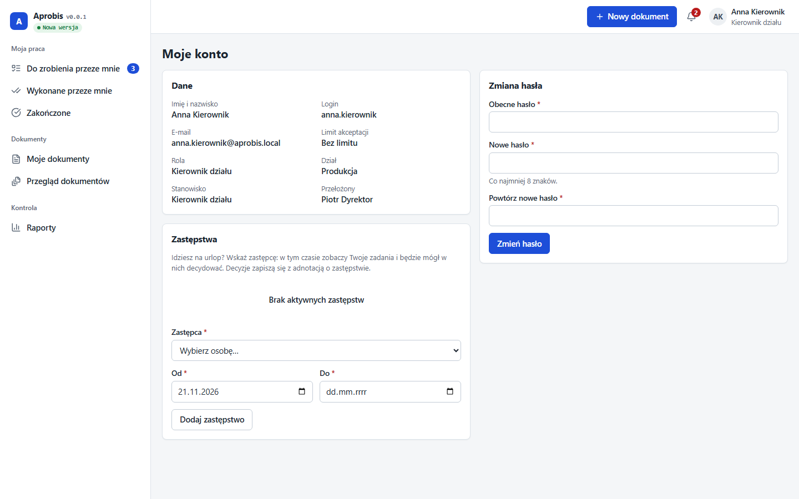

### Ustawienie i odwołanie zastępstwa

1. Kliknij swoje imię i nazwisko w prawym górnym rogu i wybierz „Moje konto i zastępstwa”.
2. W karcie „Zastępstwa” wybierz aktywnego użytkownika w polu „Zastępca”.
3. Wskaż daty „Od” i „Do”, a następnie kliknij „Dodaj zastępstwo”.
4. Aby zakończyć zastępstwo wcześniej, kliknij ikonę kosza przy wpisie na liście.

Zasady działania zastępstwa:
- obejmuje zarówno nowe zadania, jak i zadania otwarte przed rozpoczęciem zastępstwa;
- zadania zastępowanego pojawiają się na liście „Do zrobienia przeze mnie” zastępcy;
- decyzja podjęta przez zastępcę zapisuje się w historii z adnotacją „W zastępstwie: <imię i nazwisko zastępowanego>”;
- **zastępca nie może decydować o dokumentach, których autorem jest zastępowany** (przejmuje wyłącznie uprawnienia zastępowanego, a autor nigdy nie decyduje o własnym dokumencie);
- przy decyzji sprawdzany jest limit akceptacji obu osób (zastępcy i zastępowanego);
- audytor, administrator systemu oraz konto „Tylko podgląd” nie podejmują decyzji, więc nie mogą działać jako zastępcy w zadaniach decyzyjnych.

### Przekazanie a przepisanie zadania

| Czynność | Kto wykonuje | Kiedy użyć | Wymagania |
| --- | --- | --- | --- |
| **Przekaż** (w karcie decyzji) | Osoba mająca obecnie otwarte zadanie | Przekazanie pojedynczego zadania innej osobie (np. przy przekroczonym limicie albo merytorycznym podziale pracy). | Etap ma włączoną opcję „Można przekazać”; odbiorca musi mieć aktywne konto, prawo decyzji i wystarczający limit, nie może być autorem dokumentu. |
| **Przepisz** (w karcie „Narzędzia administratora”) | Wyłącznie Administrator systemu | Sytuacja awaryjna, gdy osoba akceptująca jest niedostępna i nie ustawiła zastępstwa. | Dokument ma status „W akceptacji”; wymagany powód (min. 3 znaki) zapisywany w historii; nie można przepisać na siebie ani na autora dokumentu. |

---

## 7. Raporty, dziennik zdarzeń i logi systemowe

Dostęp do danych kontrolnych jest rozdzielony według ról. Szczegółowe zestawienie znajduje się w tabeli w rozdziale [Role w systemie](#9-role-w-systemie).

### Raporty

Ekran „Raporty” w sekcji „Kontrola” jest dostępny dla ról: Kierownik działu, Dyrektor, Zarząd, Księgowość, Audytor i Administrator systemu.

- **Dokumenty według statusu** oraz **Dokumenty według typu:** wykresy liczbowe widoczne dla wszystkich ról z dostępem do raportów.
- **Zadania po terminie** (dokument, etap, u kogo utknęło, przekroczenie terminu) oraz **Czas akceptacji** (średni czas i ostatnie 20 zakończonych obiegów): tabele widoczne wyłącznie dla ról **Audytor** oraz **Administrator systemu**.

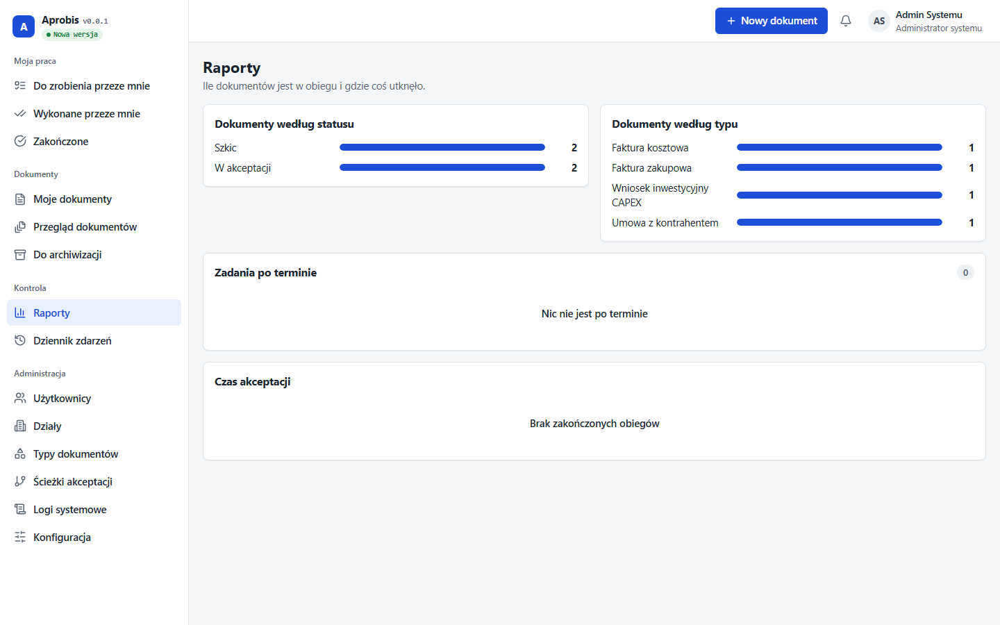

### Dziennik zdarzeń

Ekran „Dziennik zdarzeń” w sekcji „Kontrola” jest dostępny **wyłącznie dla Administratora systemu**. Zapisuje trwały ślad działań użytkowników (logowania, wylogowania, zmiany haseł, operacje na dokumentach, decyzje, skany załączników, zmiany konfiguracji i uprawnień).

Widok pokazuje ostatnie 200 wpisów (kiedy, kto, zdarzenie, czego dotyczy z linkiem „Otwórz dokument” oraz adres IP). Pole wyszukiwania filtruje wpisy po kodzie zdarzenia lub identyfikatorze. Wpisy dziennika zdarzeń nie są automatycznie usuwane.

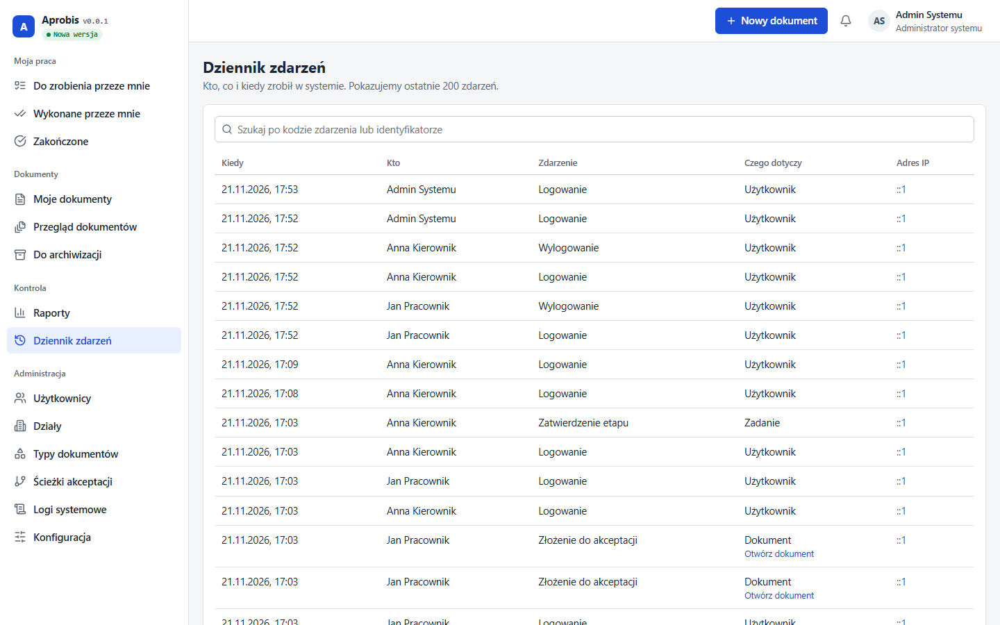

### Logi systemowe

Ekran „Logi systemowe” w sekcji „Administracja” jest dostępny **wyłącznie dla Administratora systemu**. Zawiera logi techniczne z procesów „Serwer” (API) i „Praca w tle” (worker), w tym błędy połączeń, poczty SMTP i skanera antywirusowego. Domyślny filtr pokazuje „Błędy i ostrzeżenia”; każdy wpis z kontekstem można rozwinąć przyciskiem „Szczegóły”.

Wpisy starsze niż `LOG_RETENTION_DAYS` (domyślnie 90 dni) są automatycznie usuwane przez worker. Nie dotyczy to „Dziennika zdarzeń”.

---

## 8. Administracja

Administrator systemu konfiguruje użytkowników, strukturę działów, typy dokumentów, ścieżki akceptacji i ustawienia techniczne.

**Rozdział obowiązków:** Administrator systemu celowo **nie może** podejmować decyzji w zadaniach akceptacyjnych, nie może przepisać zadania na siebie i nie może edytować treści cudzych dokumentów. Aby w firmie można było zatwierdzać dokumenty, utwórz osobne konta z rolami biznesowymi (np. Kierownik działu, Księgowość, Dyrektor, Zarząd).

### Pierwszy administrator po instalacji

Pierwsze konto z rolą `Administrator systemu` powstaje poza przeglądarką podczas instalacji (polecenie `npm run db:create-admin` opisane w instrukcjach wdrożenia). Po pierwszym zalogowaniu zmień hasło początkowe w „Moje konto” i skonfiguruj kolejno:

1. **Działy** (struktura firmy).
2. **Użytkownicy** (konta, role, przypisanie do działów, przełożeni i limity akceptacji).
3. **Typy dokumentów** (przegląd lub rozbudowa formularzy).
4. **Ścieżki akceptacji** (schematy typów oraz reguły warunkowe).
5. **Konfiguracja** (serwer poczty SMTP, sprawdzenie banera skanera antywirusowego).

### Użytkownicy

Ekran „Administracja” -> „Użytkownicy” wyświetla listę kont wraz z rolą, działem, przełożonym, limitem i statusem („Aktywne”, „Nieaktywne”, „Zablokowane”). Na dole ekranu znajduje się podpowiedź „Co oznaczają role”.

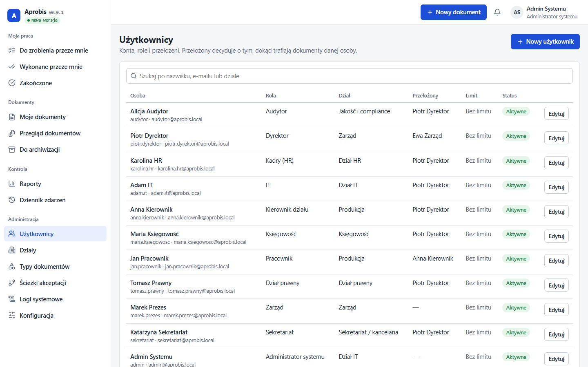

Aby dodać lub zmienić konto:

1. Kliknij „Nowy użytkownik” albo „Edytuj” przy wybranej osobie.
2. Uzupełnij „Imię”, „Nazwisko”, „E-mail” (używany do resetu hasła), opcjonalny „Login”, „Rolę”, „Dział”, „Stanowisko” oraz „Przełożony” (bez przełożonego etapy przełożonego trafiają do zarządu).
3. W sekcji „Hasło początkowe” (lub „Nowe hasło” przy edycji) możesz użyć przycisku „Wygeneruj”. Hasło wyświetla się tylko raz w oknie „Przekaż hasło użytkownikowi”; w bazie zapisywany jest wyłącznie jego skrót.
4. W sekcji „Limit akceptacji” zaznacz „Ta osoba ma limit kwoty, do której może zatwierdzać”, wpisz „Najwyższa kwota” i wybierz walutę (`PLN`, `EUR`, `USD`). Odznaczenie pola oznacza brak limitu.
5. W sekcji „Konto” pole „Konto aktywne” pozwala wyłączyć konto (bez usuwania historii). Jeśli konto jest czasowo zablokowane po 3 błędnych logowaniach, pojawia się przycisk „Odblokuj teraz”.
6. Kliknij „Zapisz”.

Własnej roli ani aktywności własnego konta administrator nie może zmienić, aby zapobiec utracie dostępu administracyjnego.

### Działy

Ekran „Administracja” -> „Działy” zarządza strukturą działów.

1. Kliknij „Nowy dział” albo „Edytuj” przy istniejącym dziale.
2. Podaj „Nazwę”, krótki „Kod” (np. `FIN`, używany w regułach warunkowych), wybierz „Kierownik” (osoba akceptująca etapy „Kierownik działu” i mająca wgląd w złożone dokumenty działu) oraz opcjonalny „Dział nadrzędny”.
3. Zaznacz lub odznacz „Dział aktywny” i kliknij „Zapisz”.

### Typy dokumentów

Ekran „Administracja” -> „Typy dokumentów” jest dostępny dla Administratora systemu oraz Administratora słowników.

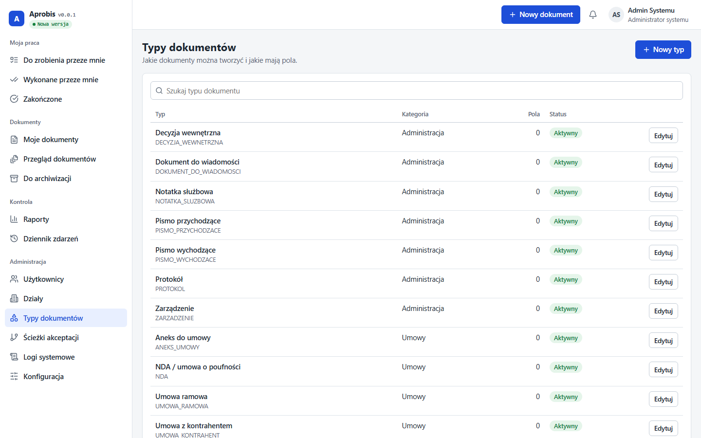

1. Kliknij „Nowy typ” albo „Edytuj” przy wybranym typie.
2. Ustaw „Nazwę”, „Kod” (np. `FAKTURA_KOSZTOWA`, używany w regułach), „Kategorię” (określa widoczność dla ról takich jak Księgowość, Kadry czy Dział prawny) oraz opcjonalny „Szablon tytułu” z tokenami pól, np. `Wniosek urlopowy {vacationStart} - {vacationEnd}`.
3. Zaznacz wymagane pola wbudowane: „Kwota wymagana”, „Kontrahent wymagany” oraz „Dostępny przy tworzeniu dokumentów”.
4. W sekcji „Pola formularza” dodaj lub zmień pola przyciskiem „Dodaj pole”. Dostępne rodzaje: „Tekst”, „Długi tekst”, „Liczba”, „Data”, „Lista wyboru” (opcje oddzielone przecinkami) oraz „Tak / nie”. Kolejność zmienisz strzałkami.
5. Kliknij „Zapisz”.

Zmiana pól formularza automatycznie tworzy i publikuje nową wersję formularza. Zmiany dotyczą wyłącznie nowo tworzonych dokumentów; istniejące dokumenty zachowują swój dotychczasowy formularz i zapisane dane. Wyłączenie typu ukrywa go na liście tworzenia, ale istniejące dokumenty nadal da się otworzyć.

### Ścieżki akceptacji

Ekran „Administracja” -> „Ścieżki akceptacji” ma dwie zakładki: **Schematy typów** oraz **Reguły warunkowe**. Zmiany dotyczą wyłącznie nowych obiegów; trwające obiegi kończą się według wersji z chwili złożenia.

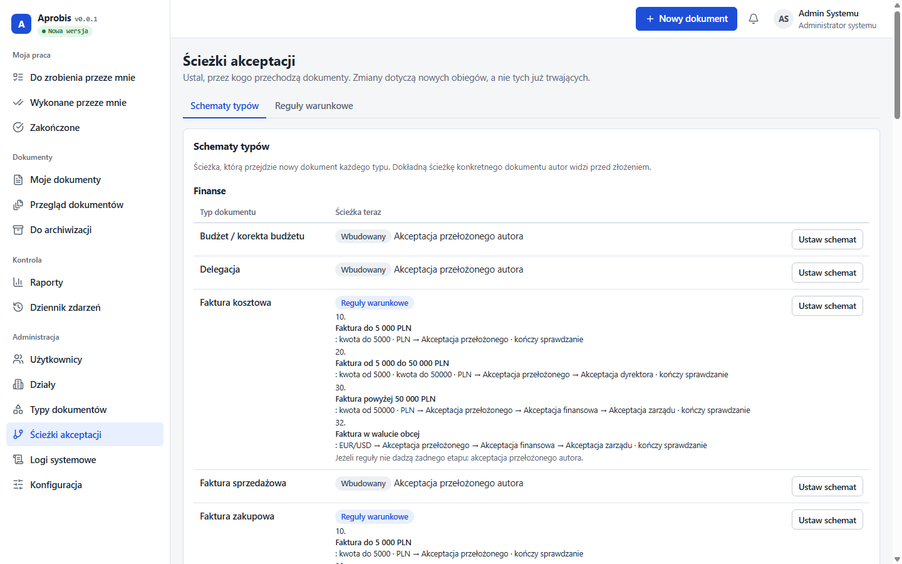

Kolejność ustalania ścieżki przy składaniu dokumentu:

1. **Stały schemat typu:** jeśli dla danego typu dokumentu opublikowano aktywny schemat, obowiązują wyłącznie jego etapy, a reguły warunkowe są dla tego typu pomijane.
2. **Reguły warunkowe:** jeśli typ nie ma aktywnego schematu, system sprawdza aktywne reguły po kolei według pola „Kolejność sprawdzania” (niższa liczba najpierw). Etapy wszystkich pasujących reguł łączą się po kolei, aż do reguły z zaznaczoną opcją „Nie sprawdzaj kolejnych reguł, gdy ta zadziała”.
3. **Domyślna ścieżka wbudowana:** jeśli nie ma schematu i żadna reguła nie pasuje, dokument trafia do bezpośredniego przełożonego autora.

Konfiguracja stałego schematu (zakładka „Schematy typów”):

1. Kliknij „Ustaw schemat” lub „Edytuj schemat” przy typie dokumentu.
2. Podaj „Nazwę schematu” i zdefiniuj etapy przyciskiem „Dodaj etap”.
3. Dla każdego etapu wybierz „Rodzaj etapu”:
   - **Decyzja (akceptuj / odrzuć / zwróć):** wybierz „Kto decyduje?” (Przełożony autora, Kierownik działu autora, Osoba z wybranej roli, Wybrane osoby, Osoba z roli w dziale, Zarząd), ustaw „Dni na decyzję” (1-365) oraz opcje: „Komentarz obowiązkowy”, „Wymagany załącznik”, „Można przekazać”, „Można zwrócić do poprawy”. Przy wielu wybranych osobach wybierz, czy potrzebna jest decyzja wszystkich, czy wystarczy jedna osoba.
   - **Do wiadomości (bez decyzji):** wybierz „Kto otrzymuje?” (Przełożony autora albo Wybrane osoby). Obieg nie czeka na reakcję odbiorcy.
4. Kliknij „Zapisz i opublikuj”. Aby wrócić dla tego typu do reguł warunkowych, użyj przycisku „Wyłącz schemat”.

Jeśli typ ma schemat zaawansowany (z etapami równoległymi, kworum lub warunkami wyjścia spoza prostego edytora), edycja jest zablokowana z banerem informacyjnym „Schemat zaawansowany”, aby nie utracić ustawień.

Konfiguracja reguły warunkowej (zakładka „Reguły warunkowe”):

1. Kliknij „Nowa reguła” albo „Edytuj” przy istniejącej regule.
2. Ustaw „Nazwę”, „Kolejność sprawdzania”, „Status” (`Aktywna` / `Wyłączona`) oraz opcjonalne daty „Obowiązuje od” i „Obowiązuje do”.
3. W sekcji „Kiedy reguła ma zadziałać?” wypełnij warunki (dokument musi spełnić wszystkie wypełnione grupy): Kategorie, Typy dokumentów, Działy autora, Kwota od, Kwota do, Słowa w tytule (oddzielone przecinkami; wystarczy jedno słowo), Waluty (`PLN`, `EUR`, `USD`). Puste pole oznacza brak ograniczenia.
4. W sekcji „Jakie etapy dodać?” dodaj co najmniej jeden etap decyzyjny i zdecyduj, czy zaznaczyć „Nie sprawdzaj kolejnych reguł, gdy ta zadziała”.
5. Kliknij „Zapisz regułę”.

Uszkodzona reguła nie jest pomijana po cichu; blokuje złożenie dokumentu, który do niej dotrze, z wyraźnym komunikatem.

### Konfiguracja systemu

Ekran „Administracja” -> „Konfiguracja” przechowuje ustawienia aplikacji w bazie. Zmiany działają w ciągu 30 sekund bez restartu serwera.

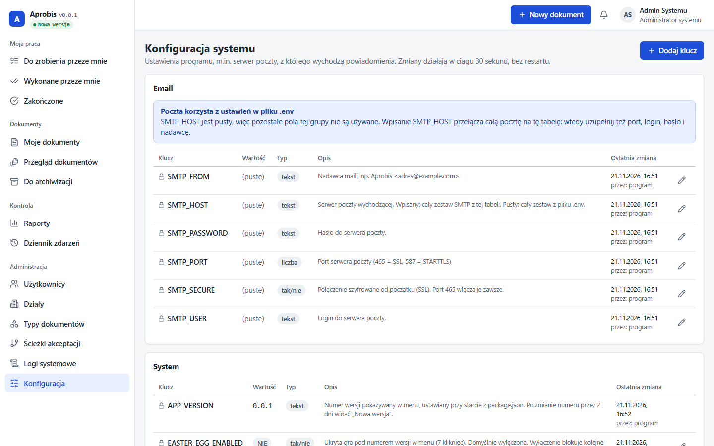

- **Stan skanera antywirusowego:** na górze ekranu pojawia się automatyczny baner z `/api/health`, jeśli skanowanie jest wyłączone (`AV_SCANNER=disabled`, baner ostrzegawczy) albo nieskonfigurowane (`unconfigured`, baner błędu). Gdy działa Windows Defender lub ClamAV, baner nie wyświetla się. Tryb skanera zmienia się wyłącznie w pliku `.env` serwera z restartem API i workera.
- **Poczta (SMTP):** baner w sekcji „Email” informuje o aktywnym źródle ustawień. Gdy klucz `SMTP_HOST` w tej tabeli jest pusty, poczta korzysta z pliku `.env` serwera. Wpisanie wartości w `SMTP_HOST` przełącza całą pocztę na tabelę „Konfiguracja” (wtedy uzupełnij też `SMTP_PORT`, `SMTP_SECURE`, `SMTP_USER`, `SMTP_PASSWORD` i `SMTP_FROM`). Klucze zawierające w nazwie `PASSWORD` lub `SECRET` są maskowane w interfejsie i w dzienniku zdarzeń; podczas edycji pozostawienie maski zachowuje dotychczasowe hasło, a przycisk „Wyczyść hasło” je usuwa.
- **Ukryta gra (`EASTER_EGG_ENABLED`):** klucz systemowy w grupie „System”, domyślnie ustawiony na `NIE` (`false`). Po ustawieniu na `TAK` 7-krotne kliknięcie numeru wersji przy logo w ciągu 5 sekund otwiera prostą grę w przeglądarce.
- **Wersja (`APP_VERSION`):** klucz tylko do odczytu, ustawiany automatycznie przy starcie serwera na podstawie `package.json`.

### Narzędzia administratora na karcie dokumentu

Na karcie dowolnego dokumentu w statusie „W akceptacji” Administrator systemu widzi po prawej stronie kartę „Narzędzia administratora” z listą otwartych zadań i przyciskiem „Przepisz”. Może też użyć przycisku „Wycofaj” na górze karty, aby zdjąć z obiegu dokument, który utknął.

---

## 9. Role w systemie

Poniższa tabela odzwierciedla dokładne uprawnienia zdefiniowane w systemie (`backend/src/shared/roles.ts`). Pamiętaj: cudze szkice widzą wyłącznie **Audytor** i **Administrator systemu**; wycofany szkic, którego nigdy nie złożono, pozostaje widoczny tylko dla autora i tych dwóch ról.

| Rola | Zakres widoczności (złożone dokumenty) | Tworzenie dokumentów | Decyzje w zadaniach | Archiwizacja | Raporty / Dziennik / Administracja |
| --- | --- | --- | --- | --- | --- |
| **Pracownik** | Własne i z własnym udziałem | Tak | Tak | Nie | Brak |
| **Kierownik działu** | Własne, z udziałem, podwładnych oraz swojego działu | Tak | Tak | Nie | Raporty (wykresy) |
| **Dyrektor** | Wszystkie złożone (także kadrowe) | Tak | Tak | Nie | Raporty (wykresy) |
| **Zarząd** | Wszystkie złożone | Tak | Tak | Nie | Raporty (wykresy) |
| **Księgowość** | Własne, z udziałem oraz wszystkie z kategorii „Finanse” | Tak | Tak | Nie | Raporty (wykresy) |
| **Dział prawny** | Własne, z udziałem oraz wszystkie z kategorii „Umowy” | Tak | Tak | Nie | Brak |
| **Kadry (HR)** | Własne, z udziałem oraz wszystkie z kategorii „Kadry” | Tak | Tak | Tak (tylko „Kadry”) | Brak |
| **Zakupy** | Własne i z własnym udziałem | Tak | Tak | Nie | Brak |
| **IT** | Własne i z własnym udziałem | Tak | Tak | Nie | Brak |
| **Sekretariat** | Wszystkie złożone poza kategorią „Kadry” | Tak | Tak | Tak (poza „Kadry”) | Brak |
| **Audytor** | Wszystkie (także szkice) | Nie | Nie | Nie | Raporty pełne (wykresy, po terminie, czasy akceptacji), katalog użytkowników. Bez „Dziennika zdarzeń” i „Logów systemowych”. |
| **Tylko podgląd** | Wyłącznie te z własnym udziałem | Nie | Nie | Nie | Brak |
| **Administrator słowników** | Własne i z własnym udziałem | Tak | Tak | Nie | „Typy dokumentów”, katalog użytkowników |
| **Administrator systemu** | Wszystkie (także szkice) | Tak | **Nie** | Tak (wszystkie kategorie) | Raporty pełne, „Dziennik zdarzeń”, „Logi systemowe”, „Użytkownicy”, „Działy”, „Typy dokumentów”, „Ścieżki akceptacji”, „Konfiguracja”, przepisywanie zadań i wycofywanie dokumentów |

---

## 10. Rozwiązywanie problemów

### Załącznik długo pozostaje w statusie „Skanowanie…”

- **Objaw:** po dodaniu pliku status „Skanowanie…” nie zmienia się przez kilkadziesiąt sekund lub dłużej i nie można pobrać pliku.
- **Przyczyna:** nie działa proces roboczy (worker), skaner antywirusowy (Windows Defender lub ClamAV) jest niedostępny albo w instalacji na Linuxie nie ustawiono zmiennej `AV_SCANNER` (tryb `unconfigured`).
- **Rozwiązanie:** poczekaj chwilę (ekran odświeża status co 3 sekundy). Jeśli status się nie zmienia, zgłoś problem administratorowi. Administrator powinien sprawdzić ekran „Administracja” -> „Konfiguracja” (baner skanera), ekran „Logi systemowe” (źródło „Praca w tle”) oraz status usługi workera na serwerze.

### Przycisk „Zatwierdź” jest nieaktywny lub pojawia się błąd przy zatwierdzaniu

- **Objaw:** na karcie dokumentu w panelu „Czeka na Twoją decyzję” przycisk „Zatwierdź” jest wyszarzony z komunikatem „Kwota przekracza Twój limit akceptacji…”, albo przy próbie decyzji pojawia się błąd braku uprawnień.
- **Przyczyna:**
  1. Kwota dokumentu przekracza Twój limit akceptacji albo dokument ma inną walutę niż Twój limit.
  2. Jesteś autorem dokumentu (lub zastępujesz autora dokumentu).
  3. Twoja rola nie ma prawa decyzji (np. Administrator systemu, Audytor, Tylko podgląd).
  4. Etap wymaga komentarza („Komentarz obowiązkowy”) lub przeskanowanego załącznika („Wymagany załącznik”).
- **Rozwiązanie:** przy przekroczonym limicie użyj przycisku „Przekaż” (wybierz osobę z wystarczającym limitem) albo „Zwróć do poprawy”. Jeśli limit lub rola są błędne, poproś administratora o zmianę w „Administracja” -> „Użytkownicy”. Jeśli brakuje komentarza lub czystego załącznika, uzupełnij je przed decyzją.

### Nie przychodzą e-maile o zadaniach albo link do resetu hasła

- **Objaw:** po kliknięciu „Nie pamiętam hasła” lub po przydzieleniu zadania nie ma wiadomości w skrzynce pocztowej.
- **Przyczyna:** poczta SMTP nie jest skonfigurowana, w tabeli „Konfiguracja” wypełniono `SMTP_HOST` bez pozostałych pól (np. bez hasła lub portu), wiadomość trafiła do folderu spam albo adres e-mail konta ma literówkę.
- **Rozwiązanie:**
  1. Sprawdź folder spam oraz adres e-mail na ekranie „Moje konto”.
  2. Pamiętaj, że Aprobis wysyła e-maile wyłącznie przy nowym zadaniu, etapie „do wiadomości” i resecie hasła (pozostałe komunikaty są pod ikoną dzwonka).
  3. Zgłoś problem administratorowi, aby sprawdził „Administracja” -> „Konfiguracja” (sekcja „Email”) oraz „Logi systemowe” pod kątem błędów wysyłki.

### Konto jest zablokowane po nieudanych logowaniach

- **Objaw:** podczas logowania pojawia się komunikat o blokadzie konta po nieudanych próbach.
- **Przyczyna:** wpisano 3 razy błędne hasło; konto zablokowało się automatycznie na 15 minut.
- **Rozwiązanie:** odczekaj 15 minut i zaloguj się ponownie, użyj opcji „Nie pamiętam hasła” (ustawienie nowego hasła zdejmuje blokadę od razu) albo poproś administratora o kliknięcie „Odblokuj teraz” w edycji Twojego konta w „Administracja” -> „Użytkownicy”.

### Dokumentu nie widać na liście

- **Objaw:** wiesz, że dokument istnieje, ale nie znajdujesz go w „Do zrobienia przeze mnie” ani w „Przeglądzie dokumentów”.
- **Przyczyna:**
  1. Dokument jest nadal szkicem innego użytkownika (cudze szkice widzą wyłącznie Audytor i Administrator systemu).
  2. Obieg nie dotarł jeszcze do Twojego etapu (w tym etapu „do wiadomości”) albo został wycofany/zwrócony, co cofnęło wgląd „do wiadomości”.
  3. Kategoria dokumentu nie mieści się w zakresie widoczności Twojej roli (np. dokument kadrowy dla Sekretariatu).
  4. Na ekranie „Przegląd dokumentów” jest włączony filtr statusu, typu albo tekstu.
- **Rozwiązanie:** wyczyść filtry w „Przeglądzie dokumentów”. Jeśli dokument ma trafić do Ciebie do decyzji, sprawdź z autorem, czy został złożony i kogo pokazuje jego „Ścieżka akceptacji”.

---

## 11. Słowniczek

- **Szkic:** nowo utworzony dokument przed złożeniem do akceptacji. Widzi go autor (oraz Audytor i Administrator systemu); można go edytować, usuwać i dodawać do niego załączniki.
- **Obieg:** uruchomiony proces akceptacji konkretnego dokumentu, złożony z jednego lub kilku etapów. Po zwrocie do poprawy i ponownym złożeniu startuje nowy obieg od pierwszego etapu.
- **Etap:** krok w obiegu (decyzyjny albo „do wiadomości”), realizowany przez wskazaną osobę, przełożonego, rolę albo grupę osób.
- **Zadanie:** konkretne zlecenie decyzji przypisane w ramach otwartego etapu decyzyjnego; widoczne w „Do zrobienia przeze mnie”.
- **Ścieżka akceptacji:** uporządkowana lista etapów wyznaczona dla dokumentu ze stałego schematu typu, z reguł warunkowych albo domyślnie do przełożonego autora.
- **Limit akceptacji:** maksymalna kwota w określonej walucie (`PLN`, `EUR`, `USD`), do której dana osoba może zatwierdzać dokumenty. Dokument powyżej limitu lub w innej walucie przechodzi wyżej w hierarchii.
- **Zastępstwo:** czasowe upoważnienie innej aktywnej osoby (ustawiane w „Moje konto”) do obsługi Twoich zadań decyzyjnych podczas nieobecności, z wyłączeniem dokumentów, których jesteś autorem.
- **Etap „do wiadomości”:** etap bez decyzji, który nadaje wskazanym osobom wgląd tylko do odczytu (bez notatek wewnętrznych) i nie zatrzymuje obiegu.
