# Aprobis user guide

> [!NOTE]
> This Markdown file is the knowledge source for a company AI assistant (for example, an internal helper answering employee questions about Aprobis). For reading and printing, use the PDF version: [Aprobis-user-guide.pdf](Aprobis-user-guide.pdf).

Aprobis manages electronic document workflows and approvals inside a company: an employee creates a document, the system assigns the approval path, and every decision is recorded in the document history and audit log.

The Aprobis interface is available in Polish only; screen names, buttons, fields, and statuses appear in Polish as shown in the application, with English explanations at first use.

This guide serves two audiences: users working with documents (employees, approvers, "for information" stage recipients, and auditors) and administrators configuring the system after installation. Server installation and maintenance are covered separately in the [Docker installation guide](instalacja-docker.md) (Polish) and the [Windows Server installation guide](instalacja-windows.md) (Polish).

> [!WARNING]
> **Early version (0.0.1).** Aprobis has not yet been deployed in production; application behavior and screen layouts may change. For version status details, see the warning at the top of [README.md](../README.md).

What the application deliberately does not do:
- it does not provide electronic signatures;
- it does not convert currencies (it supports `PLN`, `EUR`, and `USD` without exchange rates);
- it does not send an email for every event (email is sent only for a new decision task, a "for information" stage, and a password reset, provided SMTP is configured).

## Table of contents

1. [Getting started](#1-getting-started)
2. [My work](#2-my-work)
3. [Documents](#3-documents)
4. [Approval and workflow](#4-approval-and-workflow)
5. [Document revisions](#5-document-revisions)
6. [Deputies and task handover](#6-deputies-and-task-handover)
7. [Reports, audit log, and system logs](#7-reports-audit-log-and-system-logs)
8. [Administration](#8-administration)
9. [System roles](#9-system-roles)
10. [Troubleshooting](#10-troubleshooting)
11. [Glossary](#11-glossary)

---

## 1. Getting started

You sign in through a web browser with your login or email address and password. A browser session lasts 8 hours.

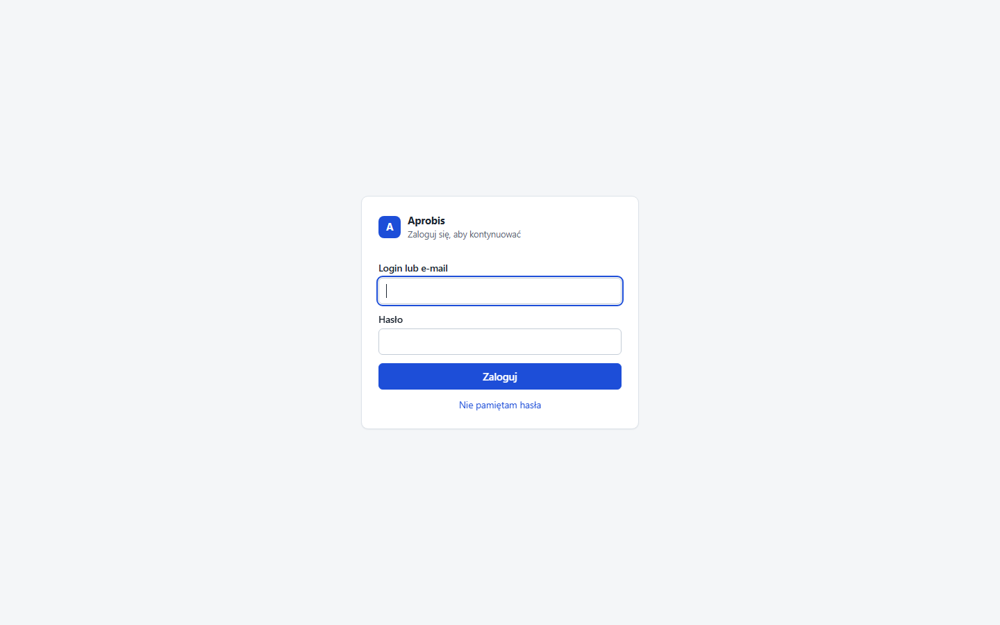

### Signing in

1. Open the URL provided by your administrator in a browser.
2. Enter your login or email address in the "Login lub e-mail" (*Login or email*) field.
3. Enter your password in the "Hasło" (*Password*) field and click "Zaloguj" (*Sign in*).

Sign-in security rules:
- after 3 failed attempts, the account locks automatically for 15 minutes (the lockout expires on its own, and an administrator can clear it earlier);
- a single IP address is limited to 10 sign-in attempts per 15 minutes and 5 password-reset requests per 15 minutes;
- passwords must be 8-128 characters long.

### Recovering a password ("Nie pamiętam hasła")

Password recovery works only when an administrator has configured an SMTP mail server.

1. On the sign-in screen, click "Nie pamiętam hasła" (*Forgot password*).
2. Enter your login or email address and click "Wyślij link" (*Send link*).
3. Open the link from the email within 1 hour. Each link works once.
4. Enter a new password (8-128 characters), repeat it, and click "Ustaw hasło" (*Set password*).

Setting a new password clears any temporary account lockout and signs out all active sessions on other devices. If you do not have access to email, ask an administrator to set a new password in "Użytkownicy" (*Users*).

### Changing your password and signing out

- To change your own password, click your full name in the top-right corner, select "Moje konto i zastępstwa" (*My account and deputies*), then in the "Zmiana hasła" (*Change password*) card enter "Obecne hasło" (*Current password*), "Nowe hasło" (*New password*), and "Powtórz nowe hasło" (*Repeat new password*), and click "Zmień hasło" (*Change password*). Changing your password ends all active sessions, so the application prompts you to sign in again.
- To sign out, click your full name in the top-right corner and select "Wyloguj" (*Sign out*).

### Screen layout

The main navigation menu on the left is divided into four groups (you see only items available to your role):

- **Moja praca** (*My work*): "Do zrobienia przeze mnie" (*My to-do list*, with a counter of open items), "Wykonane przeze mnie" (*Completed by me*), "Zakończone" (*Finished*).
- **Dokumenty** (*Documents*): "Moje dokumenty" (*My documents*), "Przegląd dokumentów" (*Document browser*), "Do archiwizacji" (*To archive*).
- **Kontrola** (*Control*): "Raporty" (*Reports*), "Dziennik zdarzeń" (*Audit log*).
- **Administracja** (*Administration*): "Użytkownicy" (*Users*), "Działy" (*Departments*), "Typy dokumentów" (*Document types*), "Ścieżki akceptacji" (*Approval paths*), "Logi systemowe" (*System logs*), "Konfiguracja" (*Configuration*).

The top bar contains:
- the "Nowy dokument" (*New document*) button (visible to roles allowed to create documents);
- the "Powiadomienia" (*Notifications*) bell icon with the unread count (clicking an entry opens the related document, and "Oznacz wszystkie" (*Mark all as read*) clears the counter);
- the user menu with "Moje konto i zastępstwa" and "Wyloguj".

The application version number (for example `v0.0.1`) appears in the top-left corner next to the application name. For 2 days after an upgrade to a newer version, a green "Nowa wersja" (*New version*) badge appears next to it.

---

## 2. My work

The "Moja praca" section gathers only items requiring your action and the history of your decisions. Role-based visibility of other people's documents never adds those documents to your task list.

### My to-do list ("Do zrobienia przeze mnie")

This is the main working view. It lists everything currently waiting for your action, grouped into four sections:

1. **Czekają na Twoją decyzję** (*Awaiting your decision*): approval tasks assigned to you, to your role, or taken over through an active deputy assignment. Each entry shows its deadline and a "Sprawdź i zdecyduj" (*Review and decide*) button. If the document amount exceeds your approval limit, the label reads "Ponad Twój limit, przekaż dalej: …" (*Over your limit, hand over: …*).
2. **Zwrócone Ci do poprawy** (*Returned to you for revision*): your documents returned by an approver, with a "Popraw dokument" (*Revise document*) button.
3. **Twoje niedokończone szkice** (*Your unfinished drafts*): documents saved as drafts and not yet submitted for approval, with a "Dokończ" (*Continue*) button.
4. **Do archiwizacji** (*To archive*): a shortcut showing the number of approved documents awaiting archiving (visible only to roles permitted to archive).

While you act as a deputy for another user, a "Masz aktywne zastępstwo" (*You have an active deputy assignment*) banner appears at the top of the screen with the represented person's name and the end date.

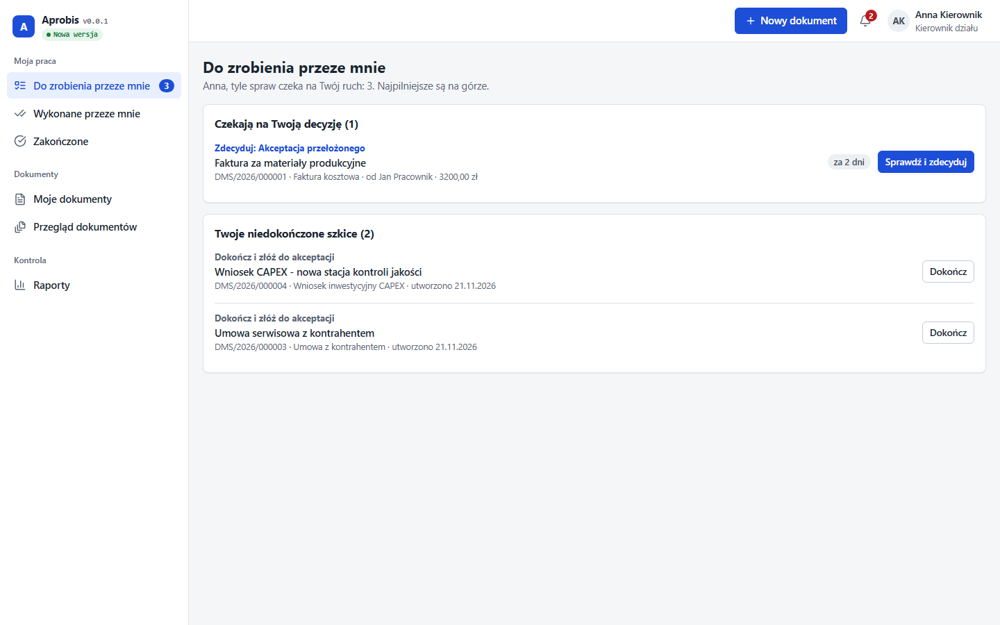

### Completed by me ("Wykonane przeze mnie")

This screen displays a chronological list of your decisions and submissions along with their comments. The right side of each entry shows the current document status and workflow state, such as "Obieg trwa, teraz u: Księgowość" (*Workflow in progress, currently with: Accounting*), "Czeka na poprawki autora" (*Waiting for author revisions*), or "Obieg zakończony" (*Workflow finished*).

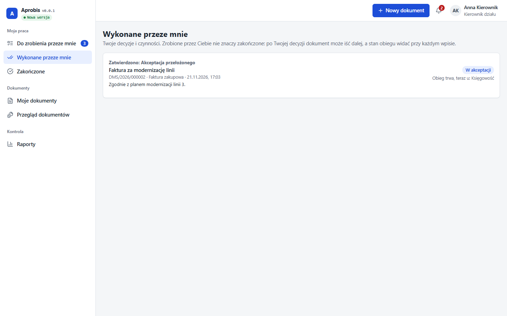

### Finished ("Zakończone")

This screen lists documents in which you participated as author or decision maker and whose workflow has closed. Tabs at the top filter the list by "Wszystkie" (*All*), "Zatwierdzone" (*Approved*, including archived documents), "Odrzucone" (*Rejected*), and "Wycofane" (*Withdrawn*).

---

## 3. Documents

A document moves through the statuses `Szkic` (*Draft*) -> `W akceptacji` (*In approval*) -> `Zatwierdzony` (*Approved*) -> `W archiwum` (*Archived*). From `W akceptacji`, it can also move to `Do poprawy` (*Needs revision*) after a return, or to `Odrzucony` (*Rejected*) after a rejection. From `Szkic`, `W akceptacji`, or `Do poprawy`, a document can be withdrawn (`Wycofany`, *Withdrawn*).

### Creating a new document

Every new document is saved as a draft first. You can inspect the full approval path and attach files before submitting it.

1. Click "Nowy dokument" on the top bar.
2. Find the document type (you can use the "Szukaj, np. faktura, urlop, umowa" (*Search, e.g. invoice, leave, contract*) field). Types are grouped into categories: "Finanse" (*Finance*), "Umowy" (*Contracts*), "Kadry" (*HR*), "Administracja" (*Administration*), "Techniczne" (*Technical*), and "Jakość i zgodność" (*Quality and compliance*).

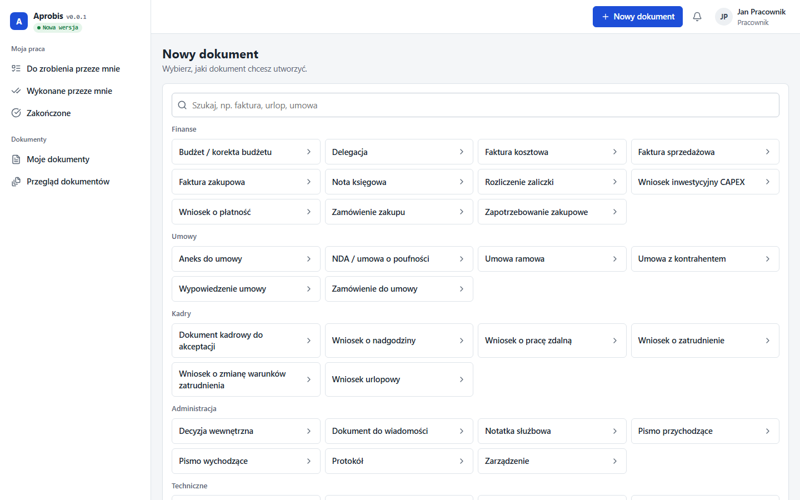

3. Click the chosen type to open the form.
4. Fill in "Tytuł" (*Title*; for some types the title is generated automatically from a template using other fields), and if the type requires them, "Kontrahent" (*Counterparty*), "Kwota" (*Amount*), "Waluta" (*Currency*: `PLN`, `EUR`, or `USD`), and the form-specific fields.
5. Optionally add files in the "Załączniki" (*Attachments*) field.
6. Click "Zapisz i przejdź dalej" (*Save and continue*). The system saves the draft and opens the document card.

Required fields are marked with an asterisk, but the system validates them only upon submission. You can save an incomplete draft and finish it later. The system assigns the document's department automatically from the author's profile.

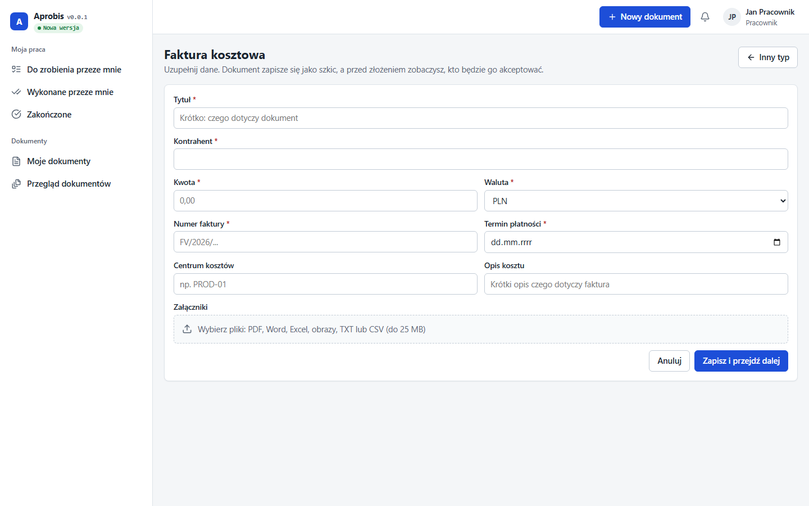

### Attachments and antivirus scanning

Allowed file formats are PDF, Word (`.doc`, `.docx`), Excel (`.xls`, `.xlsx`), images (`.jpg`, `.jpeg`, `.png`, `.gif`), `.txt`, and `.csv`. The maximum size per file is 25 MB. Only the author can add or remove attachments, and only while the document status is "Szkic" or "Do poprawy".

Every uploaded file enters a background antivirus scan performed by the worker process:

| Interface status | Meaning | Can the file be opened or downloaded |
| --- | --- | --- |
| `Skanowanie…` (*Scanning…*) | The file is waiting in the antivirus scan queue. The screen refreshes the status automatically every 3 seconds. | No |
| `Bezpieczny` (*Clean*) | The scanner found no threats. | Yes (in-window preview also works for PDFs and images) |
| `Zablokowany przez antywirus` (*Blocked by antivirus*) | The scanner detected a threat. The file blocks document submission; remove it with the trash icon. | No (permanently blocked) |
| `Nie skanowano` (*Not scanned*, with a disabled-antivirus notice) | The administrator is running the installation with scanning disabled (`AV_SCANNER=disabled`). The file has not been scanned and does not carry the "Bezpieczny" label. | Yes only while scanning is disabled. Once the scanner is enabled, the file returns to the scan queue and stays blocked until scanned. |

### Previewing the approval path and submitting

On the right side of a draft's card, the "Ścieżka akceptacji" (*Approval path*) card lists the stages, the people or roles assigned to decide, and the number of days allowed per stage.

1. Verify the document fields, attachment scan statuses, and "Ścieżka akceptacji".
2. If anything needs correction, click "Edytuj" (*Edit*).
3. Click "Złóż do akceptacji" (*Submit for approval*).

Once submitted, the document content and attachments cannot be changed unless the document is returned for revision. If the approval path lacks an active approver (for example, no line manager has a sufficient approval limit) or an active rule is broken, the system blocks submission with an error message.

### Deleting a draft versus withdrawing a document

- **Usuń szkic** (*Delete draft*): available only to the author and only for a document that has never been submitted for approval. It permanently removes the document and its attachments (this cannot be undone).
- **Wycofaj** (*Withdraw*): available to the author or system administrator for a document in "W akceptacji" or "Do poprawy" (as well as registered documents). It stops the workflow, closes open tasks, and revokes visibility granted by "do wiadomości" (*for information*) stages. This cannot be undone; the document remains in history with status "Wycofany".

### Comments and internal notes

The "Komentarze" (*Comments*) section sits at the bottom of the document card and is available to the author and users with an assigned task until the document is archived.

- A regular comment is visible to all document participants, including the author.
- Users other than the author can check "Notatka wewnętrzna: autor jej nie zobaczy" (*Internal note: the author will not see this*). Such an entry carries the "Notatka wewnętrzna" (*Internal note*) label and is hidden from the document author and from "do wiadomości" stage recipients.

### My documents, document browser, and archiving

- **Moje dokumenty** (*My documents*): only documents created by you, with tabs "Wszystkie" (*All*), "Szkice" (*Drafts*), "Do poprawy" (*Needs revision*), "W akceptacji" (*In approval*), "Zatwierdzone" (*Approved*), and "Odrzucone i wycofane" (*Rejected and withdrawn*).
- **Przegląd dokumentów** (*Document browser*): all documents visible to you through participation, line-manager responsibility, or role scope. You can search by title, number, or counterparty and filter by status and type.

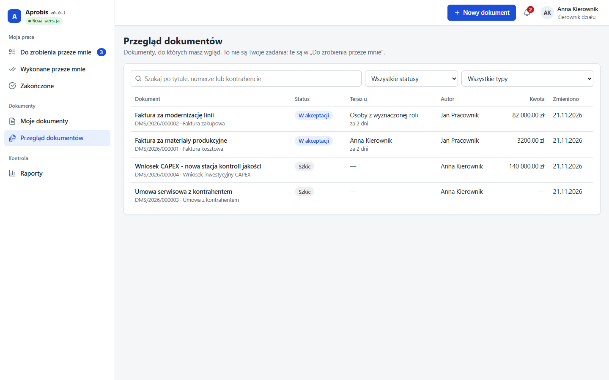

- **Do archiwizacji** (*To archive*): approved documents ready to be moved to the archive (tabs "Czekają" (*Waiting*) and "W archiwum" (*Archived*)). To archive a document, open it and click "Do archiwum" (*Move to archive*). Archiving rights belong to:
  - **Kadry (HR)** (*HR*): documents in the "Kadry" category only;
  - **Sekretariat** (*Secretariat*): all approved documents outside the "Kadry" category;
  - **Administrator systemu** (*System administrator*): all approved documents.

---

## 4. Approval and workflow

The right to decide comes from an assigned task, not from a role alone. Even if you can view a document in "Przegląd dokumentów", the decision panel appears only when the open task belongs to you, to your role, or to someone you represent as a deputy.

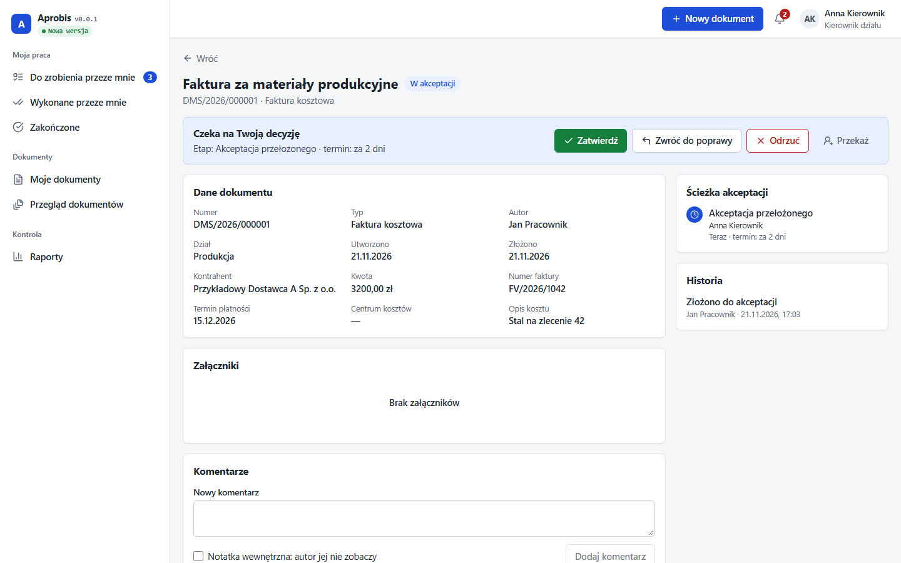

### Making a decision on a task

1. Open the task from "Do zrobienia przeze mnie" using the "Sprawdź i zdecyduj" button.
2. Review the "Dane dokumentu" (*Document details*) card, attachments, comments, and history.
3. In the "Czeka na Twoją decyzję" (*Awaiting your decision*) panel, choose an action:
   - **Zatwierdź** (*Approve*): opens a confirmation dialog (a comment is optional unless the stage enables "Komentarz obowiązkowy" (*Comment required*); the author sees the comment). The document advances to the next stage or finishes the workflow as "Zatwierdzony".
   - **Zwróć do poprawy** (*Return for revision*): visible when the stage permits it. Requires filling in "Co trzeba poprawić?" (*What needs to be revised?*). Stops the current workflow and sends the document back to the author as "Do poprawy".
   - **Odrzuć** (*Reject*): requires filling in "Powód odrzucenia" (*Reason for rejection*). Ends the workflow immediately as "Odrzucony"; this decision cannot be undone.
   - **Przekaż** (*Hand over*): visible when the stage permits it. Opens the "Przekaż zadanie" (*Hand over task*) dialog and transfers the current task to an active user with decision rights (excluding the document author, yourself, and non-decision roles).

### Approval rules and amount limits

- **No self-approval:** a document author cannot approve their own document in any role. If the approval path points to the author, the system replaces them with their line manager upon submission and adds the note "Autor był wskazany w tym etapie, więc decyduje przełożony" (*The author was assigned to this stage, so their line manager decides*).
- **Approval limits:** an administrator can assign a user a maximum amount and currency (`PLN`, `EUR`, or `USD`). Leaving the limit unset means no limit; a document without an amount never exceeds any limit.
- **Exceeding a limit:** on submission, a document above a user's limit routes to the first higher line manager whose limit is sufficient (and to the management board at the top of the chain). A limit in a different currency from the document is always treated as exceeded because the application has no exchange rates.
- **Limit changed mid-workflow:** the system re-checks the approval limit when you act on the task. If you exceed your limit, "Zatwierdź" is disabled; use "Przekaż" (only to someone with a sufficient limit) or "Zwróć do poprawy".

### Sequential, multi-person, and "for information" stages

On the "Ścieżka akceptacji" card, completed stages show a green check mark ("Zatwierdzono", *Approved*), the current stage shows a blue clock icon ("Teraz", *Now*), and future stages show "Później" (*Later*).

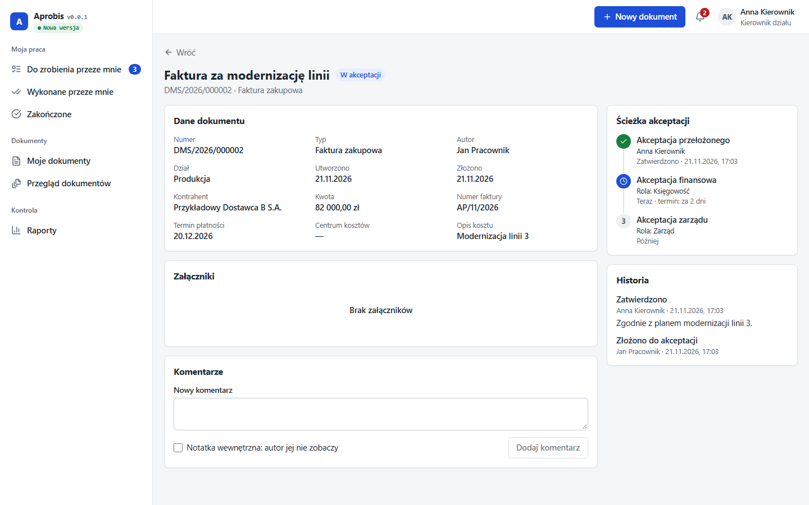

- **Sequential stages:** the next stage opens only after the current stage finishes.
- **Role or multi-person tasks:** when a stage is assigned to a role (for example "Księgowość", *Accounting*), every user in that role with a sufficient limit sees the task, and the first to act decides. When a fixed template names specific people, either all of them must decide (default) or a single decision suffices, depending on the stage setting; rejection by any assignee stops the entire workflow.
- **"For information" stage ("do wiadomości"):** creates no decision task and does not pause the workflow. When the workflow reaches this stage, the named recipient receives read-only access (without internal notes and without commenting rights). Access is revoked if the document is returned for revision or withdrawn. "For information" visibility does not transfer to a deputy.

### Deadlines, reminders, and emails

The deadline for each decision stage is counted in days from the moment the stage opens (2 days by default unless a template or rule sets a different number).

- After a deadline passes, the worker sends a one-time in-app reminder (under the "Powiadomienia" bell) and marks the deadline in red (for example "2 dni po terminie", *2 days overdue*).
- When an administrator has configured SMTP, the worker sends an email when a new decision task opens and when a "do wiadomości" stage is reached. For confidentiality, the email contains a link and task notice, without the document title or field values.

---

## 5. Document revisions

When an approver clicks "Zwróć do poprawy", the document returns to the author with status "Do poprawy". A revision is an edit by the author rather than a decision task to approve.

1. Open "Do zrobienia przeze mnie" and locate the "Zwrócone Ci do poprawy" section (the document also appears under "Moje dokumenty" in the "Do poprawy" tab).
2. Click "Popraw dokument". A yellow "Zwrócono do poprawy" (*Returned for revision*) banner at the top of the card displays the changes requested by the approver.
3. Click "Edytuj", update the fields, and save the form.
4. If needed, remove outdated files or upload new ones in "Załączniki" and wait for scanning to finish.
5. Review the updated "Ścieżka akceptacji" and click "Złóż ponownie" (*Resubmit*).

After resubmission, the workflow always restarts from stage 1, because changes to the amount, counterparty, or content can change the required approval path.

---

## 6. Deputies and task handover

Aprobis provides three separate mechanisms for changing who handles tasks: a deputy assignment (during absence), a handover (of a single task by the approver), and a reassignment (in emergencies by the system administrator).

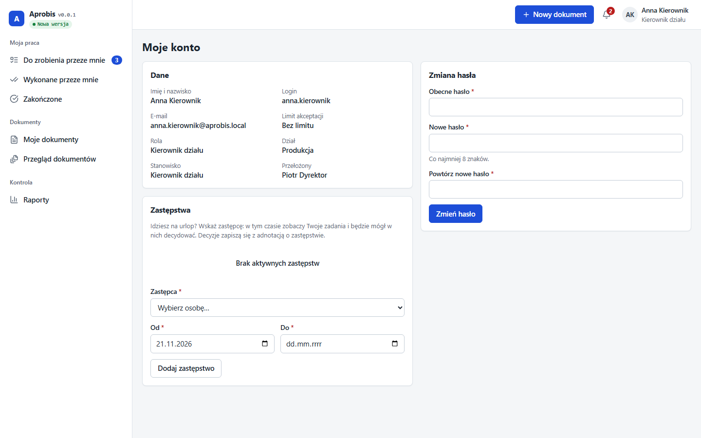

### Setting up and canceling a deputy assignment

1. Click your full name in the top-right corner and select "Moje konto i zastępstwa".
2. In the "Zastępstwa" (*Deputies*) card, pick an active user in the "Zastępca" (*Deputy*) field.
3. Set the "Od" (*From*) and "Do" (*To*) dates, then click "Dodaj zastępstwo" (*Add deputy*).
4. To end a deputy assignment early, click the trash icon next to its entry in the list.

Rules for deputy assignments:
- covers both new tasks and tasks already open before the assignment began;
- tasks of the represented person appear in the deputy's "Do zrobienia przeze mnie" list;
- a decision made by a deputy is recorded in history with the note "W zastępstwie: <name of represented person>" (*Acting as deputy for: <name>*);
- **a deputy cannot decide on documents authored by the represented person** (a deputy inherits only the represented person's rights, and an author never decides on their own document);
- the system checks the approval limit of both people (the deputy and the represented person) at decision time;
- auditors, system administrators, and "Tylko podgląd" (*Read-only*) accounts do not make decisions and cannot act as deputies for decision tasks.

### Handover versus reassignment

| Action | Performed by | When to use | Requirements |
| --- | --- | --- | --- |
| **Przekaż** (*Hand over*, in the decision panel) | The user who currently holds the open task | Passing a single task to another person (for example, after exceeding your limit or for subject-matter delegation). | The stage has "Można przekazać" (*Can hand over*) enabled; the recipient has an active account, decision rights, and a sufficient approval limit, and is not the document author. |
| **Przepisz** (*Reassign*, in the "Narzędzia administratora" card) | System administrator only | Emergency coverage when an approver is unavailable and did not configure a deputy. | The document status is "W akceptacji"; a reason (at least 3 characters) is required and saved in history; the task cannot be reassigned to the administrator themselves or to the document author. |

---

## 7. Reports, audit log, and system logs

Access to control and monitoring views is split by role. See the full permission matrix in [System roles](#9-system-roles).

### Reports ("Raporty")

The "Raporty" screen under "Kontrola" is available to these roles: Kierownik działu (*Department manager*), Dyrektor (*Director*), Zarząd (*Management board*), Księgowość (*Accounting*), Audytor (*Auditor*), and Administrator systemu (*System administrator*).

- **Dokumenty według statusu** (*Documents by status*) and **Dokumenty według typu** (*Documents by type*): count charts visible to all roles with report access.
- **Zadania po terminie** (*Overdue tasks*: document, stage, current holder, overdue duration) and **Czas akceptacji** (*Approval time*: average duration and the last 20 completed workflows): tables visible only to **Audytor** and **Administrator systemu**.

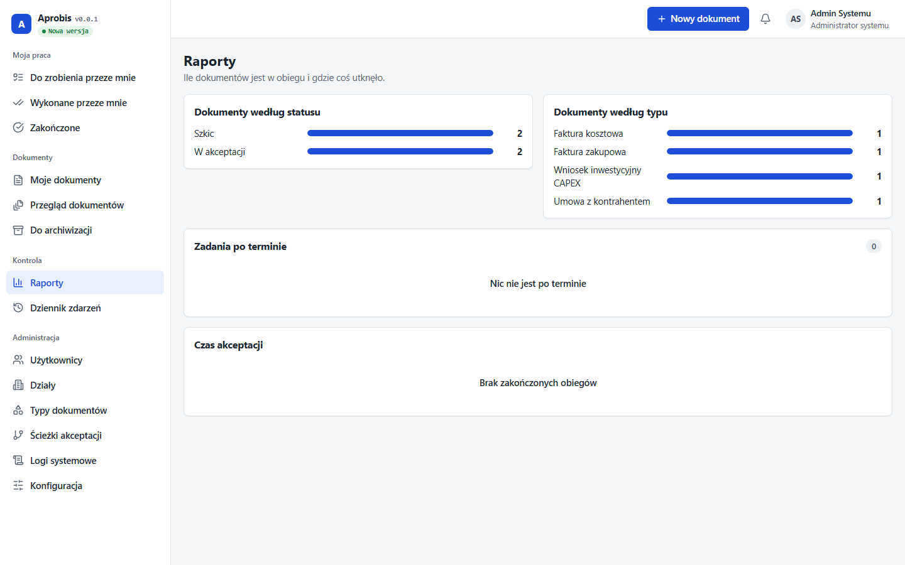

### Audit log ("Dziennik zdarzeń")

The "Dziennik zdarzeń" screen under "Kontrola" is available **only to Administrator systemu**. It keeps a permanent record of user activity (sign-ins, sign-outs, password changes, document operations, decisions, attachment scans, and configuration or permission changes).

The view displays the last 200 entries (timestamp, actor, event, target with an "Otwórz dokument" (*Open document*) link, and IP address). The search box filters entries by event code or identifier. Audit log entries are never deleted automatically.

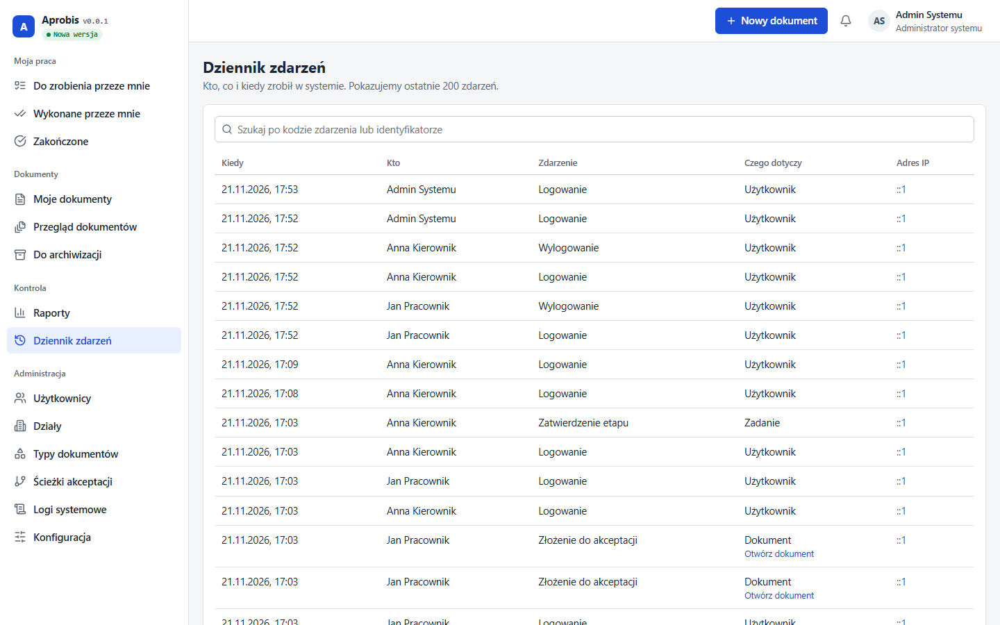

### System logs ("Logi systemowe")

The "Logi systemowe" screen under "Administracja" is available **only to Administrator systemu**. It holds technical logs from the "Serwer" (*Server*, API) and "Praca w tle" (*Background worker*) processes, including connection, SMTP mail, and antivirus scanner errors. The default filter shows "Błędy i ostrzeżenia" (*Errors and warnings*); entries with context can be expanded with "Szczegóły" (*Details*).

Entries older than `LOG_RETENTION_DAYS` (90 days by default) are removed automatically by the worker. This cleanup does not affect "Dziennik zdarzeń".

---

## 8. Administration

The system administrator configures users, department hierarchy, document types, approval paths, and technical settings.

**Separation of duties:** Administrator systemu deliberately **cannot** decide on approval tasks, reassign tasks to themselves, or edit the content of other users' documents. To approve documents in a company, create separate accounts with business roles (such as Kierownik działu, Księgowość, Dyrektor, or Zarząd).

### First administrator after installation

The first `Administrator systemu` account is created outside the browser during installation (via `npm run db:create-admin`, documented in the deployment guides). After signing in for the first time, change the initial password in "Moje konto" (*My account*) and configure the system in this order:

1. **Działy** (*Departments*): company hierarchy.
2. **Użytkownicy** (*Users*): accounts, roles, department membership, line managers, and approval limits.
3. **Typy dokumentów** (*Document types*): review or extend forms.
4. **Ścieżki akceptacji** (*Approval paths*): type templates and conditional rules.
5. **Konfiguracja** (*Configuration*): SMTP mail server and antivirus scanner banner check.

### Users ("Użytkownicy")

The "Administracja" -> "Użytkownicy" screen lists accounts with their role, department, line manager, approval limit, and status ("Aktywne" (*Active*), "Nieaktywne" (*Inactive*), "Zablokowane" (*Locked*)). A "Co oznaczają role" (*What roles mean*) reference appears at the bottom of the screen.

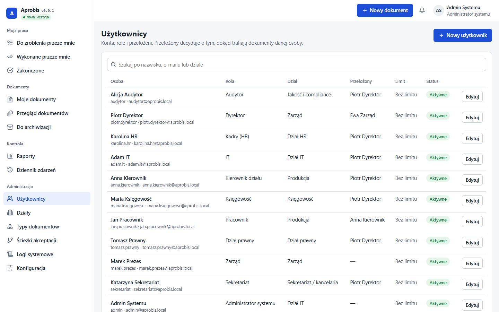

To add or edit an account:

1. Click "Nowy użytkownik" (*New user*) or "Edytuj" next to an existing person.
2. Fill in "Imię" (*First name*), "Nazwisko" (*Last name*), "E-mail" (used for password reset), optional "Login", "Rola" (*Role*), "Dział" (*Department*), "Stanowisko" (*Job title*), and "Przełożony" (*Line manager*; if left empty, line-manager stages route to the management board).
3. In "Hasło początkowe" (*Initial password*) or "Nowe hasło" (*New password* when editing), you can click "Wygeneruj" (*Generate*). The password appears once in the "Przekaż hasło użytkownikowi" (*Share password with user*) dialog; the database stores only its hash.
4. In "Limit akceptacji" (*Approval limit*), check "Ta osoba ma limit kwoty, do której może zatwierdzać" (*This person has an approval amount limit*), enter "Najwyższa kwota" (*Maximum amount*), and select the currency (`PLN`, `EUR`, `USD`). Leaving the checkbox cleared removes the limit.
5. In "Konto" (*Account*), "Konto aktywne" (*Account active*) lets you disable an account without deleting its history. When an account is temporarily locked after 3 failed sign-ins, an "Odblokuj teraz" (*Unlock now*) button appears.
6. Click "Zapisz" (*Save*).

An administrator cannot change their own role or active status, preventing accidental loss of administrative access.

### Departments ("Działy")

The "Administracja" -> "Działy" screen manages department structure.

1. Click "Nowy dział" (*New department*) or "Edytuj" next to an existing department.
2. Enter "Nazwa" (*Name*), a short "Kod" (*Code*, for example `FIN`, used in conditional rules), choose "Kierownik" (*Manager*, who approves "Kierownik działu" stages and views submitted department documents), and optionally choose "Dział nadrzędny" (*Parent department*).
3. Check or uncheck "Dział aktywny" (*Department active*) and click "Zapisz".

### Document types ("Typy dokumentów")

The "Administracja" -> "Typy dokumentów" screen is available to Administrator systemu and Administrator słowników (*Dictionary administrator*).

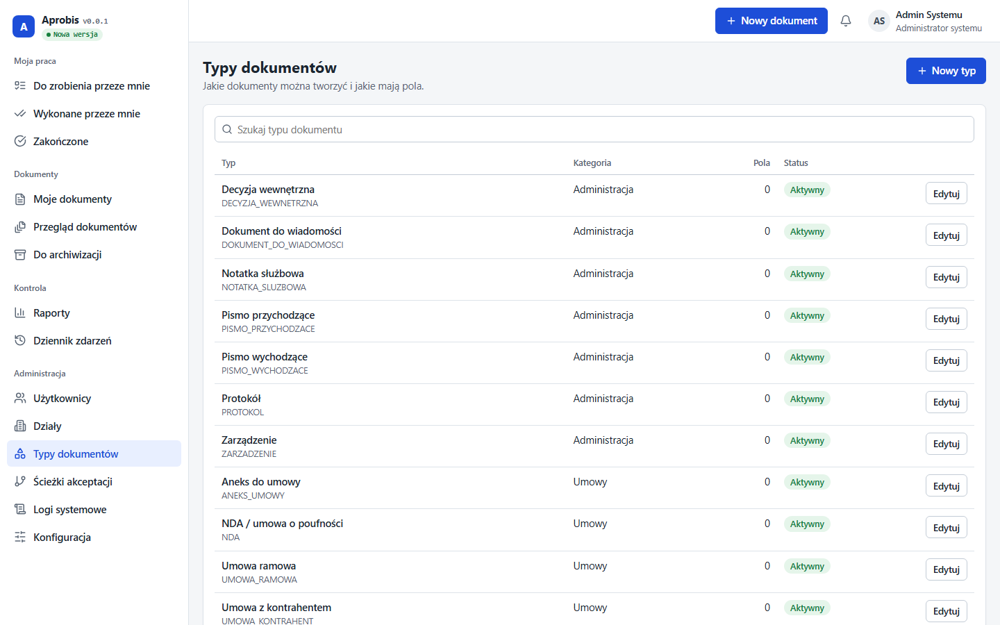

1. Click "Nowy typ" (*New type*) or "Edytuj" next to a chosen type.
2. Set "Nazwa", "Kod" (for example `FAKTURA_KOSZTOWA`, used in rules), "Kategoria" (*Category*, which controls visibility for roles such as Księgowość, Kadry, and Dział prawny), and an optional "Szablon tytułu" (*Title template*) with field tokens, for example `Wniosek urlopowy {vacationStart} - {vacationEnd}`.
3. Toggle required built-in options: "Kwota wymagana" (*Amount required*), "Kontrahent wymagany" (*Counterparty required*), and "Dostępny przy tworzeniu dokumentów" (*Available when creating documents*).
4. In "Pola formularza" (*Form fields*), add or edit fields with "Dodaj pole" (*Add field*). Available field types are "Tekst" (*Text*), "Długi tekst" (*Long text*), "Liczba" (*Number*), "Data" (*Date*), "Lista wyboru" (*Dropdown*, comma-separated options), and "Tak / nie" (*Yes / no*). Use the arrows to reorder fields.
5. Click "Zapisz".

Editing form fields automatically creates and publishes a new form version. Changes apply only to newly created documents; existing documents keep their original form and saved data. Disabling a type hides it from the creation list while existing documents remain readable.

### Approval paths ("Ścieżki akceptacji")

The "Administracja" -> "Ścieżki akceptacji" screen has two tabs: **Schematy typów** (*Type templates*) and **Reguły warunkowe** (*Conditional rules*). Changes apply only to new workflows; in-progress workflows complete under the version active at submission time.

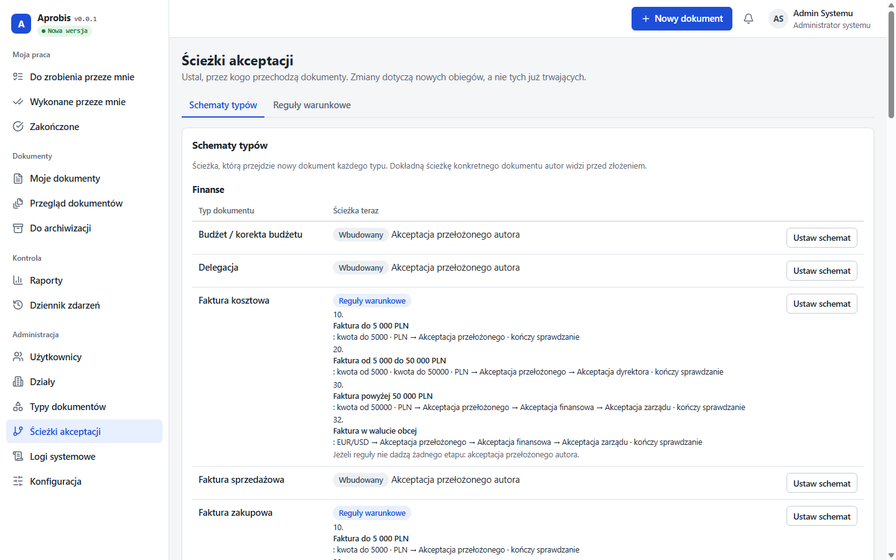

Resolution order when a document is submitted:

1. **Fixed type template:** if the document type has an active published template, only its stages apply and conditional rules are skipped for that type.
2. **Conditional rules:** if the type has no active template, the system evaluates active rules in ascending order of "Kolejność sprawdzania" (*Evaluation order*, lower numbers first). Stages from all matching rules are appended in order until a rule with "Nie sprawdzaj kolejnych reguł, gdy ta zadziała" (*Stop checking further rules when this one matches*) is reached.
3. **Built-in default path:** if no template exists and no rule matches, the document routes to the author's direct line manager.

Configuring a fixed template ("Schematy typów" tab):

1. Click "Ustaw schemat" (*Set template*) or "Edytuj schemat" (*Edit template*) next to a document type.
2. Enter "Nazwa schematu" (*Template name*) and define stages with "Dodaj etap" (*Add stage*).
3. For each stage, choose "Rodzaj etapu" (*Stage type*):
   - **Decyzja (akceptuj / odrzuć / zwróć)** (*Decision: approve / reject / return*): select "Kto decyduje?" (*Who decides?*: Przełożony autora (*Author's line manager*), Kierownik działu autora (*Author's department manager*), Osoba z wybranej roli (*Person from selected role*), Wybrane osoby (*Selected people*), Osoba z roli w dziale (*Person from role in department*), Zarząd (*Management board*)), set "Dni na decyzję" (*Days to decide*, 1-365), and toggle options: "Komentarz obowiązkowy" (*Comment required*), "Wymagany załącznik" (*Attachment required*), "Można przekazać" (*Can hand over*), "Można zwrócić do poprawy" (*Can return for revision*). When multiple specific people are selected, choose whether all must decide or one decision is enough.
   - **Do wiadomości (bez decyzji)** (*For information: no decision*): select "Kto otrzymuje?" (*Who receives it?*: Przełożony autora or Wybrane osoby). The workflow does not wait for the recipient.
4. Click "Zapisz i opublikuj" (*Save and publish*). To return the type to conditional rules, click "Wyłącz schemat" (*Disable template*).

If a type uses an advanced template (with parallel stages, quorum, or exit conditions outside the simple editor), editing is locked behind a "Schemat zaawansowany" (*Advanced template*) banner so those settings are not overwritten.

Configuring a conditional rule ("Reguły warunkowe" tab):

1. Click "Nowa reguła" (*New rule*) or "Edytuj" next to an existing rule.
2. Set "Nazwa", "Kolejność sprawdzania", "Status" (`Aktywna` (*Active*) / `Wyłączona` (*Disabled*)), and optional "Obowiązuje od" (*Valid from*) and "Obowiązuje do" (*Valid to*) dates.
3. In "Kiedy reguła ma zadziałać?" (*When should this rule trigger?*), fill in conditions (a document must satisfy every filled group): Categories, Document types, Author departments, Amount from, Amount to, Title keywords (comma-separated; any single keyword matches), and Currencies (`PLN`, `EUR`, `USD`). Leaving a group empty imposes no restriction.
4. In "Jakie etapy dodać?" (*Which stages to add?*), add at least one decision stage and choose whether to check "Nie sprawdzaj kolejnych reguł, gdy ta zadziała".
5. Click "Zapisz regułę" (*Save rule*).

A broken rule is never skipped silently; it blocks submission of any document that reaches it with an explicit error message.

### System configuration ("Konfiguracja")

The "Administracja" -> "Konfiguracja" screen stores application settings in the database. Changes take effect within 30 seconds without restarting the server.

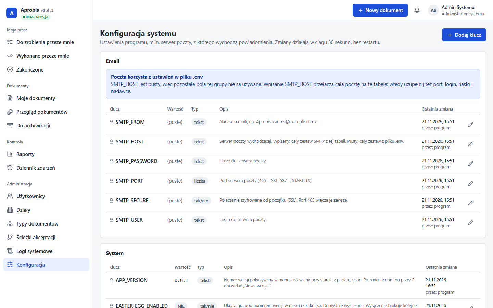

- **Antivirus scanner status:** an automatic banner sourced from `/api/health` appears at the top of the screen when scanning is disabled (`AV_SCANNER=disabled`, warning banner) or unconfigured (`unconfigured`, error banner). When Windows Defender or ClamAV is active, no banner is shown. The scanner mode is changed only in the server `.env` file, followed by restarting both the API and the worker.
- **Mail (SMTP):** a banner in the "Email" section shows the active configuration source. When `SMTP_HOST` in this table is empty, mail uses the server `.env` file. Entering a value in `SMTP_HOST` switches all mail to the "Konfiguracja" table (in that case, also fill in `SMTP_PORT`, `SMTP_SECURE`, `SMTP_USER`, `SMTP_PASSWORD`, and `SMTP_FROM`). Keys containing `PASSWORD` or `SECRET` are masked in the interface and in the audit log; leaving the mask untouched during an edit keeps the existing password, while "Wyczyść hasło" (*Clear password*) removes it.
- **Hidden game (`EASTER_EGG_ENABLED`):** a system key in the "System" group, set to `NIE` (`false`) by default. When set to `TAK` (`true`), clicking the version number next to the logo 7 times within 5 seconds opens a simple browser game.
- **Version (`APP_VERSION`):** a read-only key populated automatically from `package.json` on server startup.

### Administrator tools on a document card

On any document with status "W akceptacji", Administrator systemu sees the "Narzędzia administratora" (*Administrator tools*) card on the right with the list of open tasks and a "Przepisz" button. The administrator can also click "Wycofaj" at the top of the card to pull a stuck document out of the workflow.

---

## 9. System roles

The table below matches the exact permissions defined in `backend/src/shared/roles.ts`. Other users' drafts are visible only to **Audytor** and **Administrator systemu**; a withdrawn draft that was never submitted remains visible only to its author and those two roles.

| Role | Visibility scope (submitted documents) | Create documents | Task decisions | Archiving | Reports / Audit / Administration |
| --- | --- | --- | --- | --- | --- |
| **Pracownik** (*Employee*) | Own and participated | Yes | Yes | No | None |
| **Kierownik działu** (*Department manager*) | Own, participated, subordinates', and own department's | Yes | Yes | No | Reports (charts) |
| **Dyrektor** (*Director*) | All submitted (including HR) | Yes | Yes | No | Reports (charts) |
| **Zarząd** (*Management board*) | All submitted | Yes | Yes | No | Reports (charts) |
| **Księgowość** (*Accounting*) | Own, participated, and all in category "Finanse" | Yes | Yes | No | Reports (charts) |
| **Dział prawny** (*Legal*) | Own, participated, and all in category "Umowy" | Yes | Yes | No | None |
| **Kadry (HR)** (*HR*) | Own, participated, and all in category "Kadry" | Yes | Yes | Yes ("Kadry" only) | None |
| **Zakupy** (*Procurement*) | Own and participated | Yes | Yes | No | None |
| **IT** (*IT*) | Own and participated | Yes | Yes | No | None |
| **Sekretariat** (*Secretariat*) | All submitted except category "Kadry" | Yes | Yes | Yes (except "Kadry") | None |
| **Audytor** (*Auditor*) | All (including drafts) | No | No | No | Full reports (charts, overdue tasks, approval times), user directory. No "Dziennik zdarzeń" or "Logi systemowe". |
| **Tylko podgląd** (*Read-only*) | Participated only | No | No | No | None |
| **Administrator słowników** (*Dictionary administrator*) | Own and participated | Yes | Yes | No | "Typy dokumentów", user directory |
| **Administrator systemu** (*System administrator*) | All (including drafts) | Yes | **No** | Yes (all categories) | Full reports, "Dziennik zdarzeń", "Logi systemowe", "Użytkownicy", "Działy", "Typy dokumentów", "Ścieżki akceptacji", "Konfiguracja", task reassignment, and document withdrawal |

---

## 10. Troubleshooting

### Attachment stays in "Skanowanie…" (*Scanning…*)

- **Symptom:** after uploading a file, the "Skanowanie…" status does not change for tens of seconds or longer, and the file cannot be downloaded.
- **Cause:** the worker process is not running, the antivirus scanner (Windows Defender or ClamAV) is unavailable, or `AV_SCANNER` is not set on a Linux installation (`unconfigured` mode).
- **Resolution:** wait briefly (the screen refreshes every 3 seconds). If the status does not change, report the issue to your administrator. The administrator should check "Administracja" -> "Konfiguracja" (scanner banner), "Logi systemowe" (source "Praca w tle"), and the worker service status on the server.

### "Zatwierdź" (*Approve*) button is disabled or approval returns an error

- **Symptom:** in the "Czeka na Twoją decyzję" panel on the document card, "Zatwierdź" is grayed out with "Kwota przekracza Twój limit akceptacji…" (*Amount exceeds your approval limit…*), or attempting to decide returns a permissions error.
- **Cause:**
  1. The document amount exceeds your approval limit, or the document currency differs from your limit currency.
  2. You are the document author (or acting as deputy for the document author).
  3. Your role has no decision rights (for example Administrator systemu, Audytor, or Tylko podgląd).
  4. The stage requires a comment ("Komentarz obowiązkowy") or a scanned attachment ("Wymagany załącznik").
- **Resolution:** when your limit is exceeded, use "Przekaż" (choose someone with a sufficient limit) or "Zwróć do poprawy". If your limit or role is wrong, ask an administrator to update it under "Administracja" -> "Użytkownicy". If a comment or clean attachment is missing, add it before deciding.

### Task emails or password-reset links do not arrive

- **Symptom:** after clicking "Nie pamiętam hasła" or after a task is assigned, no email appears in your inbox.
- **Cause:** SMTP is not configured, `SMTP_HOST` was filled in under "Konfiguracja" without the remaining fields (such as password or port), the message went to spam, or the account's email address has a typo.
- **Resolution:**
  1. Check your spam folder and verify your email address on the "Moje konto" screen.
  2. Aprobis sends emails only for a new decision task, a "do wiadomości" stage, and a password reset (other alerts appear under the bell icon).
  3. Ask an administrator to inspect "Administracja" -> "Konfiguracja" ("Email" section) and "Logi systemowe" for delivery errors.

### Account is locked after failed sign-in attempts

- **Symptom:** the sign-in screen displays an account-lockout message after failed attempts.
- **Cause:** an incorrect password was entered 3 times; the account locked automatically for 15 minutes.
- **Resolution:** wait 15 minutes and sign in again, use "Nie pamiętam hasła" (setting a new password clears the lockout immediately), or ask an administrator to click "Odblokuj teraz" in your account settings under "Administracja" -> "Użytkownicy".

### Document does not appear in the list

- **Symptom:** you know a document exists, but you cannot find it in "Do zrobienia przeze mnie" or "Przegląd dokumentów".
- **Cause:**
  1. The document is still another user's draft (other users' drafts are visible only to Audytor and Administrator systemu).
  2. The workflow has not yet reached your stage (including a "do wiadomości" stage), or the document was withdrawn or returned, which revoked "do wiadomości" visibility.
  3. The document category falls outside your role's visibility scope (for example an HR document for Sekretariat).
  4. A status, type, or search filter is active on "Przegląd dokumentów".
- **Resolution:** clear the filters in "Przegląd dokumentów". If the document should reach you for decision, check with the author that it has been submitted and verify who appears on its "Ścieżka akceptacji".

---

## 11. Glossary

- **Draft ("Szkic"):** a newly created document before submission for approval. Visible to its author (as well as Audytor and Administrator systemu); can be edited, deleted, and updated with attachments.
- **Workflow ("Obieg"):** an active approval process for a specific document, made up of one or more stages. Returning a document for revision and resubmitting it starts a new workflow from stage 1.
- **Stage ("Etap"):** a step in a workflow (either a decision stage or a "do wiadomości" stage), handled by a named person, line manager, role, or group of people.
- **Task ("Zadanie"):** a specific decision assignment created by an open decision stage; displayed under "Do zrobienia przeze mnie".
- **Approval path ("Ścieżka akceptacji"):** the ordered list of stages determined for a document from a fixed type template, conditional rules, or the default path to the author's line manager.
- **Approval limit ("Limit akceptacji"):** the maximum amount in a given currency (`PLN`, `EUR`, `USD`) that a user may approve. A document above the limit or in a different currency escalates up the management chain.
- **Deputy assignment ("Zastępstwo"):** temporary authorization of another active user (configured in "Moje konto") to handle your decision tasks while you are away, excluding documents you authored.
- **"For information" stage (etap "do wiadomości"):** a non-decision stage that grants read-only access (without internal notes) to selected people without pausing the workflow.
